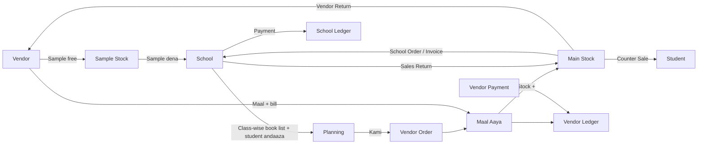

# Business Requirement Document (BRD)
# Book Inventory, Billing & Ledger System — Phase 1

| Point | Detail |
| --- | --- |
| Version | 1.0 (Draft) |
| Tareekh | 14-11-2026 |
| Banane wala | HAUT IT Solutions |
| Clients | Children Book Center, ABC Book Center (aage aur companies) |
| Tech stack (tay) | .NET (backend API), Angular (frontend, PWA), SignalR (realtime scan), SQL database, Cloud hosting (HTTPS) |
| Status | Client review ke liye |

---

## 1. Parichay (Introduction)

### 1.1 Purpose
Ye document Phase 1 ki saari business requirement, business rules, flows aur khule sawal ek jagah rakhta hai. Isi se development ka **spec** aur **plan** banega.

### 1.2 Business ka parichay
- Client publication aur vendor se **books, copy aur stationery** (pen, pencil, bag, tie aadi) khareedte hain.
- Ye maal **schools ko** bechte hain, do tarike se:
  1. **School Order**: school ko seedha bikri, udhaar par, school ka ledger banta hai.
  2. **Counter Sale**: school me school ke naam se cash counter lagakar **student ko** seedha bikri.
- Session shuru hone se pehle school ko **sample books** dete hain. Sample vendor se free milte hain.
- School aur vendor dono se **return** hota hai.
- School aur vendor dono ka **ledger** banta hai aur PDF print karke diya jata hai.

### 1.3 Phase 1 ka scope (summary)

| # | Module | Code |
| --- | --- | --- |
| 1 | Company (multi-company) | CMP |
| 2 | User aur Role | USR |
| 3 | School Master | SCH |
| 4 | Vendor Master | VEN |
| 5 | Item Master | ITM |
| 6 | Price Management | PRC |
| 7 | Stock | STK |
| 8 | Class-wise Book List aur Planning | PLN |
| 9 | Vendor Order (Purchase Order) | PO |
| 10 | Maal Aaya (Purchase) | PUR |
| 11 | School Order aur Invoice | ORD |
| 12 | Counter Sale | CNT |
| 13 | Sample | SMP |
| 14 | Return (School aur Vendor) | RET |
| 15 | Payment (Receive aur Pay) | PAY |
| 16 | Ledger | LED |
| 17 | Reports aur Dashboard | RPT |
| 18 | Barcode Scan (Scanner + Mobile) | SCN |

---

## 2. Poora Business Chakra (End-to-end Flow)

**Saal bhar ka kram:**

| Step | Kaam | Module |
| --- | --- | --- |
| 1 | Vendor se sample aaye (free) | SMP |
| 2 | School ko sample diye | SMP |
| 3 | School ne class-wise book list confirm ki aur student ka andaaza diya | PLN |
| 4 | System ne zarurat aur stock milakar kami nikali | PLN |
| 5 | Kami ka vendor order diya | PO |
| 6 | Vendor se maal aaya | PUR |
| 7 | School Order ya Counter Sale se bikri | ORD, CNT |
| 8 | School se payment | PAY |
| 9 | Session end par school return, phir vendor return | RET |
| 10 | Vendor ko payment | PAY |
| 11 | Ledger PDF school aur vendor ko | LED |

---

## 3. Users aur Roles

| Kaam | Owner | Staff |
| --- | --- | --- |
| Company, user, setting | Haan | Nahi |
| School, vendor, item master | Haan | Haan (delete nahi) |
| Price badalna (single, bulk, Excel) | Haan | Nahi |
| School Order, Invoice, Counter Sale | Haan | Haan |
| Sample, Return, Maal Aaya, Vendor Order | Haan | Haan |
| Payment receive aur vendor payment | Haan | Haan |
| Invoice, payment ya return cancel karna | Haan | Nahi |
| Ledger aur report | Haan | Haan |
| Stock value aur profit report | Haan | Nahi |

- **FR-USR-01**: User login (mobile/email + password).
- **FR-USR-02**: Har user ko ek ya zyada company ka access.
- **FR-USR-03**: Login ke baad upar dropdown se company chunna. Uske baad saari screen, number series, logo aur data usi company ka.
- **FR-USR-04**: Har entry par kisne aur kab banayi/badli ka record (audit).

---

## 4. Module-wise Functional Requirements

### 4.1 Company (Multi-company) — CMP

| ID | Requirement |
| --- | --- |
| FR-CMP-01 | Company master: naam, address, mobile, email, GSTIN, PAN, state, logo, tagline |
| FR-CMP-02 | Har company ka **ek bank account**: bank naam, account number, IFSC, branch, UPI ID (invoice par chhapega) |
| FR-CMP-03 | Invoice setting: terms and conditions, footer, signature image |
| FR-CMP-04 | Alag number series: Invoice, Counter Bill, Receipt, Credit Note, Debit Note, Vendor Order, Sample Challan, Sample Return. Financial year (Apr-Mar) par reset. Prefix set kar sakein (jaise CBC/26-27/0001) |
| FR-CMP-05 | Saara data company-wise alag. Nayi company sirf master entry se jud jaye, code change nahi |

### 4.2 School Master — SCH

| ID | Requirement |
| --- | --- |
| FR-SCH-01 | School: naam, code, address, contact person, mobile, email, GSTIN (optional), state |
| FR-SCH-02 | **Session type**: Apr-Mar ya Jan-Dec |
| FR-SCH-03 | **Sale type**: School Order, Counter Sale, ya dono |
| FR-SCH-04 | **GST default**: Haan / Nahi |
| FR-SCH-05 | Class list (Nursery se 12th), school-wise badal sakein |
| FR-SCH-06 | Opening balance (system shuru karte waqt ka purana baaki) |
| FR-SCH-07 | Excel se bulk import |
| FR-SCH-08 | School active/inactive |

### 4.3 Vendor / Publication Master — VEN

| ID | Requirement |
| --- | --- |
| FR-VEN-01 | Vendor: naam, code, address, contact, mobile, email, GSTIN, state, bank details |
| FR-VEN-02 | Opening balance |
| FR-VEN-03 | Excel se bulk import |

### 4.4 Item Master — ITM

| ID | Requirement |
| --- | --- |
| FR-ITM-01 | Item: naam, code, category (Book, Copy, Pen, Pencil, Bag, Tie, Other), publication/vendor, class, subject |
| FR-ITM-02 | **Barcode / ISBN**: ek item ke ek se zyada barcode. Barcode optional |
| FR-ITM-03 | **Stock manage: Haan / Nahi**. Book aur Copy = Haan, baaki = Nahi (default category se) |
| FR-ITM-04 | GST rate % (books 0%), HSN code |
| FR-ITM-05 | Variant alag item (jaise "Tie - Small", "Tie - Large") |
| FR-ITM-06 | Excel se bulk import aur bulk update (100-200+ rows), galat rows ki error report |
| FR-ITM-07 | Search: naam, code, barcode, publication, class |
| FR-ITM-08 | Item active/inactive |

### 4.5 Price Management — PRC

| ID | Requirement |
| --- | --- |
| FR-PRC-01 | Har item ke **kai price version**. Har version me: version naam (jaise 2026-27), **MRP**, **Sale price**, **Purchase price**, lagu hone ki tareekh |
| FR-PRC-02 | Order/bikri me default **sabse naya version**. Har line me dropdown se purana version chun sakein, ya rate seedha likh sakein |
| FR-PRC-03 | Single item ka naya version banana ya edit |
| FR-PRC-04 | **Bulk badlav**: vendor, category, class ya poori list chuno → % ya ₹ se badhao/ghatao (MRP, Sale, Purchase alag-alag) → **preview** → lagao |
| FR-PRC-05 | Excel upload: barcode/code, version, MRP, Sale, Purchase |
| FR-PRC-06 | Naye saal me pichle version ko poora copy, phir sirf badle hue edit |
| FR-PRC-07 | Price history: kab, kisne, kya badla |
| FR-PRC-08 | Purchase me vendor ka rate purchase price se alag ho to warning + "naya version banayein?" option |

### 4.6 Stock — STK

| ID | Requirement |
| --- | --- |
| FR-STK-01 | Stock **sirf "Stock manage = Haan"** wale items (Book, Copy) ka |
| FR-STK-02 | Har item ki **ek hi total quantity** (purana/naya stock alag nahi) |
| FR-STK-03 | Stock **transaction-based**: har movement ek entry (type, document, qty in/out, tareekh) |
| FR-STK-04 | Stock + : Maal Aaya, School Return (Achhi halat), Opening stock, Adjustment |
| FR-STK-05 | Stock − : School Order Invoice, Counter Sale, Vendor Return, Adjustment |
| FR-STK-06 | Stock kam ya zero hone par **sirf warning**, bikri nahi rukegi. Stock **negative** ja sakta hai |
| FR-STK-07 | **Kharab stock** alag: school return me "Kharab" wali books main stock me nahi judengi, kharab stock me judengi. Kharab stock vendor ko return ho sakta hai |
| FR-STK-08 | **Sample stock** alag (dekhein 4.13), main stock par asar nahi |
| FR-STK-09 | Stock adjustment (ginti ke baad sudhaar) karan ke saath, sirf Owner |
| FR-STK-10 | Opening stock Excel se |

### 4.7 Class-wise Book List aur Planning — PLN

| ID | Requirement |
| --- | --- |
| FR-PLN-01 | **Class-wise book list**: school + session + class → books aur har student ko qty |
| FR-PLN-02 | List har saal badal sakti hai. Pichle session ki list **ek click me copy**, phir 1-2 book jodo/hatao |
| FR-PLN-03 | School poora set na le to sirf kuch books. Koi minimum nahi. School ki special book bhi jud sakti hai |
| FR-PLN-04 | List **sirf madad** ke liye: order/bikri me list ke bahar ki book bhi chal sakti hai |
| FR-PLN-05 | Pichle aur is session ki list ka antar dikhe |
| FR-PLN-06 | **Student ka andaaza**: school + session + class → approx student count (school list nahi deta) |
| FR-PLN-07 | Zarurat = student × books per student, + buffer % (user tay kare) |
| FR-PLN-08 | **Planning report**: Book, class, andaaza, zarurat, abhi stock, pending vendor order, kami, ab tak bikri |
| FR-PLN-09 | Sab schools ki zarurat jodkar book-wise total kami (vendor se ek baar me mangwane ke liye) |
| FR-PLN-10 | School Order aur Counter Sale, dono tarah ke schools ke liye |
| FR-PLN-11 | Kami se **ek click me vendor-wise Vendor Order** draft |
| FR-PLN-12 | Andaaza vs asli bikri ka milan (session end par) |

### 4.8 Vendor Order (Purchase Order) — PO

| ID | Requirement |
| --- | --- |
| FR-PO-01 | Vendor order: vendor, tareekh, items, qty, rate (purchase price default) |
| FR-PO-02 | Planning se auto-draft ya hath se |
| FR-PO-03 | **PDF** (company logo ke saath) vendor ko bhejne ke liye |
| FR-PO-04 | Status: Draft, Diya gaya, Aadha aaya, Poora aaya, Band |
| FR-PO-05 | Vendor Order se **stock nahi badhega** aur **ledger me kuch nahi** chadhega |
| FR-PO-06 | Pending report: vendor-wise kya aana baaki |

### 4.9 Maal Aaya (Purchase) — PUR

| ID | Requirement |
| --- | --- |
| FR-PUR-01 | Vendor, vendor bill number, bill tareekh, items, qty, rate, discount (item aur total, % ya ₹) |
| FR-PUR-02 | Items **scan** ya search se |
| FR-PUR-03 | Vendor Order chunne par uski pending books apne aap bhar jayein. Jitna aaya utna likho, baaki pending |
| FR-PUR-04 | Stock: sirf stock wale items ka + |
| FR-PUR-05 | **Sab items** (stock wale aur bina stock wale) ka amount **vendor ledger me Credit** |
| FR-PUR-06 | GST: vendor bill me ho to likh sakein (optional) |
| FR-PUR-07 | Vendor bill ki photo/PDF attach (optional) |

### 4.10 School Order aur Invoice — ORD

| ID | Requirement |
| --- | --- |
| FR-ORD-01 | School chuno → session apne aap (dekhein rule BR-SES), GST default school se |
| FR-ORD-02 | Ek order me **100-200+ items**. Items **barcode scan**, naam/code search, ya **class ki book list se** ek click me |
| FR-ORD-03 | Same item dobara scan → qty +1 |
| FR-ORD-04 | Barcode system me na mile → "Item not found" message, item add nahi hoga |
| FR-ORD-05 | Har line: item, price version (dropdown), MRP, rate, qty, **item discount (% ya ₹)**, amount |
| FR-ORD-06 | **Total discount (% ya ₹)** poore order par |
| FR-ORD-07 | GST toggle (school default se, order par badal sakein). On ho to item ke GST rate se, same state CGST+SGST, bahar IGST |
| FR-ORD-08 | Stock kam/zero par line par **peela warning**, order nahi rukega |
| FR-ORD-09 | **Draft save** (beech me chhod kar baad me khol sakein) |
| FR-ORD-10 | Order confirm → **Invoice** banega → **PDF** (logo, GSTIN, bank details, items, discount, total, total shabdon me) |
| FR-ORD-11 | Ek order ke ek se zyada invoice (partial delivery) — default: haan |
| FR-ORD-12 | Invoice par **price snapshot** save: baad me price badalne par invoice nahi badlegi |
| FR-ORD-13 | Invoice → stock − (stock wale items), **school ledger Debit** |
| FR-ORD-14 | Invoice edit nahi, sirf **cancel** (Owner) karan ke saath. Cancel par stock aur ledger ulta |
| FR-ORD-15 | 200 line ka PDF kai page me, har page par header aur page number, aakhri page par total |

### 4.11 Counter Sale (School ke naam se cash counter) — CNT

| ID | Requirement |
| --- | --- |
| FR-CNT-01 | **Counter** banana: school + session + tareekh(en) (jaise "Sunrise School Counter 2027-28") |
| FR-CNT-02 | Bill par: **Class (zaroori)**, **Student naam (zaroori)**, section, roll/admission no., parent mobile (optional) |
| FR-CNT-03 | Student naam type karte hi us school ke purane naam suggest, taaki duplicate na bane. Student record counter par hi banega (pehle se list nahi) |
| FR-CNT-04 | Class chunte hi **us class ki book list** apne aap, "sab chuno" ek click me |
| FR-CNT-05 | Scan, search, aur bina barcode wale items (pen, bag, tie) ke liye **category ke bade button** |
| FR-CNT-06 | Item discount aur total discount (% ya ₹) |
| FR-CNT-07 | Payment: **Cash ya UPI** (ya dono mix), turant |
| FR-CNT-08 | GST toggle (default band) |
| FR-CNT-09 | Chhota **receipt** print (thermal ya A5) ya PDF |
| FR-CNT-10 | Stock − (stock wale items). **School ledger me nahi** chadhega |
| FR-CNT-11 | Ek student ke kai bill, sab uske naam par jude |
| FR-CNT-12 | **Din ka close**: kitni bikri, kitna Cash, kitna UPI, kitni books |
| FR-CNT-13 | Counter par student return (khula sawal Q-06) |

### 4.12 Return — RET

**A. School Return (Sales Return / Credit Note)**

| ID | Requirement |
| --- | --- |
| FR-RET-01 | School chuno, items **scan**/search. Optional: invoice chun kar usi ki books me se |
| FR-RET-02 | **Rate**: jis invoice ka hai usi rate par (item discount ke saath). Bina invoice → us school ka aakhri rate, badal sakein |
| FR-RET-03 | Invoice ka total discount return amount par **anupaat (proportion)** se katega |
| FR-RET-04 | Har line: **Achhi** (main stock +) ya **Kharab** (kharab stock +) |
| FR-RET-05 | Karan: session end, kharab, galat book, other |
| FR-RET-06 | Jitni bechi usse zyada return par warning |
| FR-RET-07 | **Credit Note PDF** |
| FR-RET-08 | **School ledger Credit** (poora amount, achhi ya kharab dono) |
| FR-RET-09 | School ko paisa wapas dena ho to "Refund" payment entry (ledger Debit) |

**B. Vendor Return (Purchase Return / Debit Note)**

| ID | Requirement |
| --- | --- |
| FR-RET-10 | Vendor chuno, items scan/search, rate purchase wala (badal sakein) |
| FR-RET-11 | Main stock ya kharab stock, kahan se ja raha hai chunna |
| FR-RET-12 | Bina stock wale items ka return bhi (sirf amount) |
| FR-RET-13 | **Debit Note PDF** |
| FR-RET-14 | **Vendor ledger Debit**: vendor ka baaki ghatega. Vendor paisa wapas nahi karta, **refund entry nahi** |

### 4.13 Sample — SMP

| ID | Requirement |
| --- | --- |
| FR-SMP-01 | **Sample stock alag**, main stock par koi asar nahi |
| FR-SMP-02 | **Vendor se sample aaya** (free): vendor, items, qty. **Vendor ledger me kuch nahi** |
| FR-SMP-03 | **School ko sample diya**: school, session, items (scan), qty → **Sample Challan PDF** (sirf qty, amount nahi). Sample stock − |
| FR-SMP-04 | **School se sample wapas**: sample stock + |
| FR-SMP-05 | **Sample se bill**: school ke paas rakhe sample me se items chun kar **Invoice** (normal invoice jaisi, discount ke saath). **Main stock nahi ghatega**. School ledger Debit |
| FR-SMP-06 | **Vendor ko sample wapas**: Sample Return Note PDF (sirf qty). Vendor ledger me kuch nahi |
| FR-SMP-07 | Har sample line ka status: Dukaan me, School ke paas, Wapas aaya, Bill ban gaya, Vendor ko wapas |
| FR-SMP-08 | **30 din alert**: school ko diye sample 30 din me wapas ya bill nahi → alert + report me laal |
| FR-SMP-09 | Sample dete waqt usi screen se school ki **class-wise book list** banana (FR-PLN-01) |

### 4.14 Payment — PAY

**A. School se Payment Receive**

| Tarika | Fields |
| --- | --- |
| Bank transfer | Tareekh, amount, UTR number |
| UPI | Tareekh, amount, UPI transaction ID |
| Cash | Tareekh, amount |
| Cheque | Cheque number, cheque tareekh, school ka bank, amount |

| ID | Requirement |
| --- | --- |
| FR-PAY-01 | School chuno → **baaki (due)** turant dikhe |
| FR-PAY-02 | Ek payment me tarike **mix** (jaise ₹5,000 Cash + ₹10,000 Cheque) |
| FR-PAY-03 | Partial aur **advance** payment |
| FR-PAY-04 | Payment invoice par adjust: default sabse purani invoice par (FIFO), hath se bhi chun sakein |
| FR-PAY-05 | **Receipt PDF** (logo ke saath) |
| FR-PAY-06 | School ledger **Credit** |
| FR-PAY-07 | **Cheque status**: Pending → Clear / Bounce. Bounce par ledger me ulti entry (school ka baaki wapas badhe), karan ke saath |
| FR-PAY-08 | Har company ka ek hi bank account, isliye account chunna nahi |

**B. Vendor ko Payment**

| Tarika | Fields |
| --- | --- |
| Bank transfer | Tareekh, amount, UTR number |
| Cheque | Cheque number, tareekh, amount |

| ID | Requirement |
| --- | --- |
| FR-PAY-09 | Vendor chuno → vendor ka baaki dikhe |
| FR-PAY-10 | Partial payment (vendor ko kabhi full payment nahi hota) |
| FR-PAY-11 | Vendor ledger **Debit** |
| FR-PAY-12 | Payment voucher PDF |

### 4.15 Ledger — LED

| ID | Requirement |
| --- | --- |
| FR-LED-01 | **School ledger**: Invoice (Dr), Sample bill (Dr), Payment (Cr), Return Credit Note (Cr), Cheque bounce (Dr), Refund (Dr), Opening balance |
| FR-LED-02 | **Vendor ledger**: Purchase (Cr), Payment (Dr), Debit Note (Dr), Opening balance |
| FR-LED-03 | Filter: school/vendor, **session**, **financial year**, **tareekh se tareekh**, "saare session" |
| FR-LED-04 | Columns: Tareekh, Document type, Document no., Detail, Debit, Credit, Running balance |
| FR-LED-05 | Pending cheque wali entry par "Pending" nishaan |
| FR-LED-06 | Filter ke pehle ka baaki **opening balance** ban kar upar dikhe |
| FR-LED-07 | Session ke baad baaki naye session me **opening balance** |
| FR-LED-08 | **PDF print** (company logo, school/vendor details, filter, summary: total Dr, total Cr, closing balance) aur Excel |
| FR-LED-09 | Ledger se document par click karke invoice/receipt kholna |
| FR-LED-10 | **Outstanding report**: sab schools ka baaki ek list me, sab vendors ka dena ek list me |

### 4.16 Reports aur Dashboard — RPT

| Report | Filter | Output |
| --- | --- | --- |
| School ledger | School, session, tareekh | Screen, PDF, Excel |
| Vendor ledger | Vendor, tareekh, FY | Screen, PDF, Excel |
| Outstanding (school/vendor) | Company, session | Screen, PDF, Excel |
| Stock report | Item, category, vendor | Kam stock alag, negative stock alag |
| Kharab stock | Item, vendor | Screen, PDF |
| Stock value | Aaj ke purchase price se | Sirf Owner |
| Sales report | School, session, tareekh, item | School Order + Counter |
| Purchase report | Vendor, tareekh, item | Screen, Excel |
| Counter report | School, session, class, student, tareekh | School-wise, class-wise, student-wise, din-wise (Cash/UPI) |
| Sample report | School, vendor, status | 30 din se zyada laal |
| Planning report | School, session | Zarurat, stock, kami |
| Vendor order pending | Vendor | Kya aana baaki |
| Return report | School, vendor, karan | Screen, Excel |
| Payment report | Tarika, tareekh | Cash, UPI, Bank, Cheque alag. Pending cheque list |
| Price history | Item | Screen |

**Dashboard (Home):**
- 4 bade button: **Naya Order**, **Maal Aaya**, **Payment**, **Sample Dena** (+ Counter Sale).
- Cards: aaj ki bikri, school outstanding, vendor dena, kam stock count, 30 din se zyada sample, pending cheque.

### 4.17 Barcode Scan — SCN

| ID | Requirement |
| --- | --- |
| FR-SCN-01 | **USB/Bluetooth barcode scanner** laptop par (keyboard ki tarah). Scan box par cursor hamesha |
| FR-SCN-02 | **Mobile camera scan** (Angular PWA, app install nahi) |
| FR-SCN-03 | Laptop par "Scan session" start → QR dikhe → mobile se QR scan karke jud jaye |
| FR-SCN-04 | Mobile ka scan **SignalR** se laptop ki screen par turant line me |
| FR-SCN-05 | Scan in jagah: School Order, Counter Sale, Maal Aaya, Return, Sample, Stock check |
| FR-SCN-06 | Scan par aawaz/vibration: mila (beep), nahi mila (alag aawaz) |
| FR-SCN-07 | Mobile hotspot se laptop internet par, server cloud par HTTPS (camera ke liye HTTPS zaroori) |

---

## 5. Business Rules (ek jagah)

### 5.1 Session aur Saal — BR-SES

| ID | Rule |
| --- | --- |
| BR-SES-01 | Do alag cheezein: **School session** (school ka, Apr-Mar ya Jan-Dec) aur **Financial year** (company ka, hamesha Apr-Mar) |
| BR-SES-02 | Invoice number, GST aur company accounts → **financial year** (invoice ki tareekh se) |
| BR-SES-03 | School ledger, order, counter, sample, planning → **school session** |
| BR-SES-04 | Apr-Mar school: **Feb-Mar** ka order **aane wale session** ka (jaise Feb 2027 → 2027-28) |
| BR-SES-05 | Jan-Dec school: **15 Nov se Dec** ka order **aane wale session** ka (jaise Dec 2026 → 2027) |
| BR-SES-06 | Session apne aap bharega, user ek click me badal sakta hai |
| BR-SES-07 | Pichle session ka baaki pichle session me rahega, naye session ke ledger me opening balance ban kar aayega |

**Session nikalne ka logic:**

| School type | Order ki tareekh | Session |
| --- | --- | --- |
| Apr-Mar | 01-Feb-2027 se 31-Mar-2027 | 2027-28 |
| Apr-Mar | 01-Apr-2027 se 31-Jan-2028 | 2027-28 |
| Jan-Dec | 15-Nov-2026 se 31-Dec-2026 | 2027 |
| Jan-Dec | 01-Jan-2027 se 14-Nov-2027 | 2027 |

> Cut-off tareekh (Apr-Mar ke liye 1 Feb, Jan-Dec ke liye 15 Nov) setting me rakhi jaye, taaki badal sakein.

### 5.2 Price — BR-PRC

| ID | Rule |
| --- | --- |
| BR-PRC-01 | Price item ka hota hai, stock lot ka nahi. Kai version, user tay karta hai kaun sa lagana |
| BR-PRC-02 | Default: sabse naya version |
| BR-PRC-03 | Document (invoice, bill, return) me rate snapshot save, baad me kabhi nahi badlega |
| BR-PRC-04 | Return: original invoice ke rate par |

### 5.3 Discount — BR-DIS

| ID | Rule |
| --- | --- |
| BR-DIS-01 | Do level: **Item discount** aur **Total discount** |
| BR-DIS-02 | Dono **% ya ₹** (toggle) |
| BR-DIS-03 | Kram: Line amount = Rate × Qty − Item discount. Subtotal = sab lines ka jod. Total discount subtotal par. GST (on ho to) discount ke baad |
| BR-DIS-04 | Total discount GST ke liye lines par anupaat se baanta jayega (andar se) |
| BR-DIS-05 | Rounding: final amount nazdeeki rupaye me, round-off alag line |

### 5.4 GST — BR-GST

| ID | Rule |
| --- | --- |
| BR-GST-01 | Books par GST nahi (0%) |
| BR-GST-02 | Default GST **band**. School ki demand par hi |
| BR-GST-03 | School master me default, order/bill par toggle |
| BR-GST-04 | On hone par item ke GST rate se, **exclusive** (price ke upar) — default, confirm karna hai |
| BR-GST-05 | Same state → CGST + SGST, bahar → IGST (company state vs school state) |
| BR-GST-06 | GST off ho to invoice par GST column nahi dikhega (simple invoice) |

### 5.5 Stock — BR-STK

| ID | Rule |
| --- | --- |
| BR-STK-01 | Sirf Book aur Copy ka stock. Pen, pencil, bag, tie, other: bina stock, seedha bikri |
| BR-STK-02 | Teen stock: **Main**, **Kharab**, **Sample** |
| BR-STK-03 | Warning, rok nahi. Negative allowed |
| BR-STK-04 | Vendor Order se stock nahi badhta, sirf Maal Aaya se |
| BR-STK-05 | Sample se bani invoice main stock nahi ghatati |

**Stock movement table:**

| Document | Main stock | Kharab stock | Sample stock | School ledger | Vendor ledger |
| --- | --- | --- | --- | --- | --- |
| Maal Aaya | + | | | | Cr |
| Vendor Order | | | | | |
| School Invoice | − | | | Dr | |
| Counter Sale | − | | | | |
| School Return (Achhi) | + | | | Cr | |
| School Return (Kharab) | | + | | Cr | |
| Vendor Return | − (ya Kharab −) | | | | Dr |
| Vendor se Sample aaya | | | + | | |
| School ko Sample diya | | | − (school ke paas) | | |
| School se Sample wapas | | | + | | |
| Sample se Bill | | | (bill ho gaya) | Dr | |
| Vendor ko Sample wapas | | | − | | |
| School Payment | | | | Cr | |
| Cheque Bounce | | | | Dr | |
| Vendor Payment | | | | | Dr |

### 5.6 Payment aur Ledger — BR-LED

| ID | Rule |
| --- | --- |
| BR-LED-01 | School ledger: Dr = school ko dena hai, Cr = school ne diya ya wapas kiya |
| BR-LED-02 | Vendor ledger: Cr = hume vendor ko dena hai, Dr = humne diya ya wapas kiya |
| BR-LED-03 | Counter Sale school ledger me nahi |
| BR-LED-04 | Sample (free) kisi ledger me nahi, sirf bill banne par school ledger me |
| BR-LED-05 | Koi bhi posted document delete nahi hoga, sirf cancel (ulti entry) |

---

## 6. Documents (PDF)

| Document | Kab | Amount? | Size |
| --- | --- | --- | --- |
| Tax Invoice / Invoice | School Order confirm | Haan | A4, multi-page |
| Counter Receipt | Counter Sale | Haan | Thermal 80mm / A5 |
| Payment Receipt | School payment | Haan | A5 |
| Credit Note | School return | Haan | A4 |
| Debit Note | Vendor return | Haan | A4 |
| Vendor Order | PO | Haan (rate) | A4 |
| Payment Voucher | Vendor payment | Haan | A5 |
| Sample Challan | School ko sample | Nahi (sirf qty) | A4 |
| Sample Return Note | Vendor ko sample wapas | Nahi | A4 |
| School Ledger | Report | Haan | A4 |
| Vendor Ledger | Report | Haan | A4 |

**Har PDF par:** company logo, naam, address, GSTIN (ho to), document number, tareekh, party details, page number. Invoice par bank details aur UPI QR, total shabdon me, signature.

---

## 7. Non-Functional Requirements

| ID | Requirement |
| --- | --- |
| NFR-01 | **Cloud hosting**, HTTPS (mobile camera ke liye zaroori) |
| NFR-02 | Laptop browser (Chrome/Edge) aur mobile (PWA) |
| NFR-03 | Internet: mobile hotspot par chal sake, halke data par |
| NFR-04 | Scan se line add < 1 second (scanner), < 2 second (mobile se SignalR) |
| NFR-05 | 200 line ka order bina atke chale. 200 line ka PDF < 5 second |
| NFR-06 | **Daily auto backup**, 30 din tak rakha jaye |
| NFR-07 | Password hashed, JWT login, role-based access, company-wise data alag |
| NFR-08 | Audit log: kaun, kab, kya |
| NFR-09 | Indian format: ₹, dd-mm-yyyy, lakh/crore me amount, total shabdon me (Indian system) |
| NFR-10 | UI aasaan: bade button, kam screen, ek screen par kaam khatam, keyboard shortcuts |
| NFR-11 | Multi-company: nayi company bina code change |
| NFR-12 | Excel import/export (books, school, vendor, price, opening stock) |

### 7.1 Aasaani ke niyam (UX)
- Home par sirf rozana ke 4-5 kaam, baaki menu me.
- Company aur session upar hamesha dikhe.
- Order screen par cursor hamesha scan box me.
- Har list me search aur filter.
- Bulk badlav se pehle hamesha preview.
- Warning peeli, error laal, kaam rukna sirf zaroori jagah.

---

## 8. Data Model (main entities)

> Har table me `CompanyId`, `CreatedBy`, `CreatedOn`, `ModifiedBy`, `ModifiedOn`, `IsActive`.

| Entity | Mukhya fields |
| --- | --- |
| Company | Name, Address, GSTIN, PAN, State, Logo, Tagline, Bank fields, UPI Id, InvoiceTerms |
| NumberSeries | CompanyId, DocType, FinancialYear, Prefix, LastNo |
| User, Role, UserCompany | Login, role, company access |
| School | Code, Name, Address, State, GSTIN, SessionType (AprMar/JanDec), SaleType, GstDefault, OpeningBalance |
| SchoolClass | SchoolId, ClassName, Order |
| Vendor | Code, Name, Address, State, GSTIN, Bank, OpeningBalance |
| ItemCategory | Name, StockManagedDefault |
| Item | Code, Name, CategoryId, VendorId, Class, Subject, HSN, GstRate, IsStockManaged |
| ItemBarcode | ItemId, Barcode (unique per company) |
| ItemPriceVersion | ItemId, VersionName, EffectiveFrom, MRP, SalePrice, PurchasePrice |
| Session | SchoolId/Type, Name (2027-28 / 2027), StartDate, EndDate |
| ClassBookList | SchoolId, SessionId, ClassName, ItemId, QtyPerStudent |
| StudentEstimate | SchoolId, SessionId, ClassName, ApproxCount |
| StockLedger | ItemId, StockType (Main/Damaged/Sample), DocType, DocId, QtyIn, QtyOut, Date |
| PurchaseOrder + Lines | VendorId, Date, Status; Lines: ItemId, Qty, ReceivedQty, Rate |
| Purchase + Lines | VendorId, BillNo, BillDate, PoId; Lines: ItemId, Qty, Rate, Discount |
| SalesOrder + Lines | SchoolId, SessionId, Status (Draft/Confirmed), GstApplied |
| Invoice + Lines | SchoolId, SessionId, FinancialYear, InvoiceNo, Date, Source (Order/Sample), Subtotal, ItemDiscount, TotalDiscountType/Value, GST, RoundOff, Total, Status; Lines: ItemId, PriceVersionId, MRP, Rate, Qty, DiscType/Value, GstRate, Amount (snapshot) |
| Counter | SchoolId, SessionId, Name, StartDate, EndDate |
| Student | SchoolId, Name, ClassName, Section, RollNo, Mobile |
| CounterBill + Lines + Payments | CounterId, StudentId, ClassName, Total; payments Cash/UPI |
| SalesReturn + Lines | SchoolId, InvoiceId?, Reason; Lines: ItemId, Qty, Rate, Condition (Good/Damaged) |
| PurchaseReturn + Lines | VendorId, Reason; Lines: ItemId, Qty, Rate, FromStock (Main/Damaged) |
| SampleTransaction + Lines | Type (FromVendor/ToSchool/FromSchool/ToVendor/Billed), PartyId, SessionId, Date; Lines: ItemId, Qty, Status |
| PaymentReceipt + Modes | SchoolId, Date, Total; Modes: Mode (Bank/UPI/Cash/Cheque), Amount, RefNo, ChequeNo, ChequeDate, Bank, ChequeStatus |
| PaymentAllocation | ReceiptId, InvoiceId, Amount |
| VendorPayment + Modes | VendorId, Date; Modes: Bank/Cheque |
| PartyLedger | PartyType (School/Vendor), PartyId, SessionId, FinancialYear, Date, DocType, DocId, Debit, Credit |
| AuditLog | Entity, EntityId, Action, OldValue, NewValue, User, Time |

**Design ke mukhya faisle:**
1. Multi-tenant by `CompanyId` (ek database).
2. Stock aur ledger **transaction tables** se (balance kabhi seedha update nahi, entries se calculate/cache).
3. Document lines me **price snapshot**.
4. Posted document edit nahi, cancel = reverse entries.

---

## 9. Defaults aur Khule Sawal (Open Questions)

Jab tak client na bole, ye **default** maan kar chalenge:

| ID | Sawal | Default |
| --- | --- | --- |
| Q-01 | GST inclusive ya exclusive | **Exclusive** (price ke upar) |
| Q-02 | Order ki partial delivery (ek order ke kai invoice) | **Haan** |
| Q-03 | Counter par school ko commission ya hissa | **Nahi** (Phase 1 me nahi) |
| Q-04 | Counter par bhi GST bill chahiye kabhi? | Toggle rahega, default band |
| Q-05 | Session cut-off tareekh (1 Feb, 15 Nov) fix ya badalne wali | Setting me, badal sakein |
| Q-06 | Counter par student ka return | Haan, chhota return (cash/UPI wapas) |
| Q-07 | Counter ke liye alag stock bhejna (godown se counter) | **Nahi**, seedha main stock se |
| Q-08 | Receipt printer: thermal (80mm) ya A4/A5 | Dono format |
| Q-09 | Invoice par UPI QR code | Haan |
| Q-10 | Users kitne honge (approx) | Owner 1-2, Staff 3-5 |
| Q-11 | Purana data (school, books, baaki) Excel me milega? | Excel import ready |
| Q-12 | SMS/WhatsApp par invoice ya ledger bhejna | Phase 1 me nahi |

---

## 10. Phase 1 me Nahi (Out of Scope)

| Cheez | Kab |
| --- | --- |
| Purana aur naya stock alag ginna (batch-wise) | Zarurat ho to baad me |
| Godown/counter ke beech stock transfer | Baad me |
| WhatsApp/SMS/Email par document bhejna | Phase 2 |
| Tally export, GST return (GSTR) report | Phase 2 |
| Student ya parent ka online order | Phase 2+ |
| Offline mode (bina internet) | Zarurat ho to baad me |
| Profit/margin ki detail report | Phase 2 |
| Expense, staff salary | Scope me nahi |

---

## 11. Acceptance (Phase 1 kab poora maana jayega)

1. Dono companies alag logo aur number series se invoice bana sakein.
2. 200 books ka order scanner aur mobile scan se ban kar PDF nikle.
3. Item aur total discount (% aur ₹) sahi calculate ho.
4. Sample → class list → planning → vendor order → maal aaya → bikri ka poora chakra chale.
5. Counter Sale se class-wise aur student-wise report nikle.
6. School aur vendor return se stock aur ledger sahi badle (achhi/kharab).
7. School ledger session aur tareekh filter se PDF me nikle, balance sahi ho.
8. Cheque bounce par ledger apne aap sudhre.
9. Bulk price update preview ke saath ho, purani invoice na badle.
10. Stock kam hone par warning aaye, par bikri na ruke.

---

*Next step: is BRD ke approve hone ke baad VS Code me isse **Spec** (API, screens, DB schema) aur **Development Plan** (sprint/module order) banaya jayega.*
