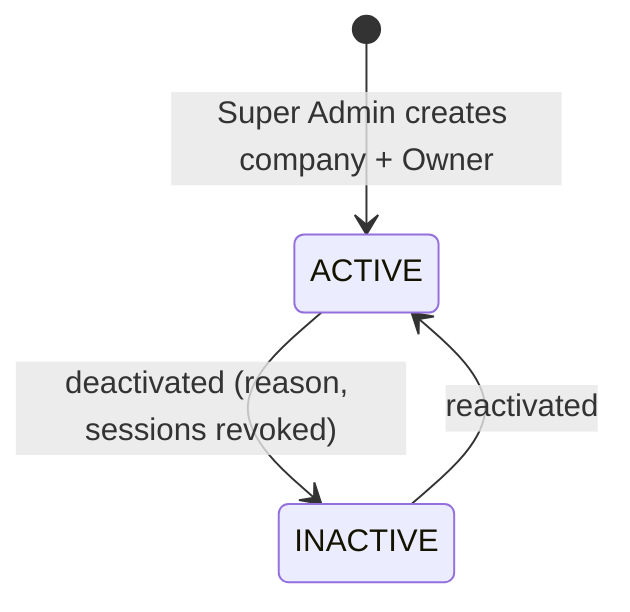

# Spec: company - Companies and their accounts

- **Module:** `company` (PostgreSQL schema `company`)
- **Status:** R1-R14 Approved by the owner on 2026-11-14 (AC1-AC15, D1-D10 with them); R15 and AC16 Approved by abhishek in chat on 2026-11-14; R16 and AC17 Approved by abhishek on 2026-11-15 (for the sales spec); R21 and AC22 (the Owner edits the company profile) Approved by abhishek on 2026-11-15 (Q19 with the recommended answer); R17-R20 and AC18-AC20 (the invoice identity: logo, signature, bank account, invoice settings and the capability to read them) Approved by abhishek on 2026-11-15 (Q17 and Q18 with the recommended answers).
- **Last updated:** 2026-11-14 (R10: `companies/current` answers `company: null`, not 404, when there is none); 2026-11-15 (for the sales spec and the invoice PDF: R17-R20)
- **Source docs:** [BRD §3 Users aur Roles, §4.1 Company (FR-CMP-01 to FR-CMP-03, FR-CMP-05), §6 Documents, §7 (NFR-07, NFR-08, NFR-11), §8 Data Model](../bussiness/BRD-Book-Inventory-Phase1.md); the owner's requests and answers of 2026-11-14 (each company has its own account and logs in; the company creates its staff logins; one Super Admin manages the companies); the owner's instructions of 2026-11-15 (every company has its own account number and account details, a logo, its full name and address)
- **Plans:** [company#10](../plans/company/2026-11-15-10-owner-company-profile.md) (Done, R21, AC22), [company#09](../plans/company/2026-11-15-09-one-bank-account-rule.md) (Done, R19, AC21), [company#08](../plans/company/2026-11-15-08-ui-company-invoice-identity.md) (In progress, R17-R20, AC18-AC20), [company#07](../plans/company/2026-11-15-07-company-invoice-identity.md) (Done, R17-R20, AC18-AC20), [company#06](../plans/company/2026-11-15-06-company-tax-profile.md) (Done, R16, AC17), [company#05](../plans/company/2026-11-14-05-company-url-slug.md) (Done, R15, AC16), [company#01](../plans/company/2026-11-14-01-company-master-and-owner-account.md) (Done), [company#02](../plans/company/2026-11-14-02-ui-company-management-screens.md) (In progress), [company#03](../plans/company/2026-11-14-03-super-admin-enters-a-company.md) (Done), [company#04](../plans/company/2026-11-14-04-ui-company-picker.md) (In progress); in `iam`: [iam#01](../plans/iam/2026-11-14-01-company-linked-accounts.md) (Done), [iam#02](../plans/iam/2026-11-14-02-ui-company-account-login.md) (In progress), [iam#03](../plans/iam/2026-11-14-03-owner-manages-staff-accounts.md) (Done), [iam#04](../plans/iam/2026-11-14-04-ui-owner-staff-screens.md) (In progress)

> One spec per module. It says WHAT the module does and WHY, never implementation steps (those live in plans).

## 1. Purpose and scope

`company` answers "which business is this, and who may use it": the master record of each company that uses the system, and the rule that every company works with its own data. In Phase 1 there are two companies: **Children Book Center** and **ABC Book Center** (BRD §1); more are added later as a master entry, never as a code change (FR-CMP-05, NFR-11).

Feature **Company accounts** (R1-R14): a Super Admin creates a company together with its first login account (the **Owner**); the Owner creates **Staff** logins for the company's people; everyone logs in with their own user id and sees only their company; the Super Admin manages all companies and can enter any active company to see and work with its data.

Accounts, logins, passwords and sessions stay in `iam` ([specs/iam.md](iam.md) R59-R69); this module never stores a password or a session.

Feature **Company invoice identity** (R17-R20): the **logo** and **signature image**, the one **bank account** and the **invoice settings** (terms, footer, whether the GSTIN prints) that the company's documents carry, and the capability other modules read them through (FR-CMP-02, FR-CMP-03). Approved with the invoice PDF feature (sales R28) on 2026-11-15.

Out of scope for this feature (a later feature of this module, Q11): number series (FR-CMP-04). Out of scope for ever in Phase 1: one login working for two companies (D3).

## 2. Concepts and glossary

- **Company**: one business using the system. Its data is separate from every other company (R1).
- **Super Admin**: the platform administrator, role `SUPER_ADMIN` of `iam`. Belongs to no company and manages all companies (R2); may enter a company (R13).
- **Owner**: the main login account of a company, role `OWNER`. Created together with the company (R4).
- **Staff**: a login account created by the Owner for the company's people, role `STAFF`. May only create orders and sell to customers (R14, D5).
- **Company account**: any `iam` account that belongs to a company (Owner or Staff).
- **User id**: the login name of a company account, generated from the company's name (D4, Q15). Company accounts never log in with email or mobile.
- **Company status**: `ACTIVE` or `INACTIVE` (R7).
- **Entering a company**: a Super Admin chooses a company; from then on, until they leave, company-owned reads and writes of their session apply to that company (R13).

## 3. Business rules

**Company accounts**
- **R1** A company is a separate business. Its data is separate from every other company's (FR-CMP-05, NFR-07). Adding a company is a master entry, not a code change (NFR-11).
- **R2** Only a `SUPER_ADMIN` creates, deactivates and reactivates companies and edits their **name and state** (Q12). The Owner of a company edits only the other master data of **their own** company (R21).
- **R3** A company has: **name** (required, unique ignoring case and surrounding spaces, 2-150 characters), address, mobile, email, GSTIN, PAN, state, tagline (FR-CMP-01). Only the name is required at creation (Q7). Logo, bank account, invoice settings and number series are later features (Q11).
- **R4** Creating a company also creates its Owner account, in the same transaction, through the `iam` capability (iam R61): the Super Admin gives the Owner's full name; the system generates the **user id from the company's name** (D4, Q15) and a temporary password. The user id and the password are shown **once** (iam R57) and the Owner must change the password at first login (iam R12). If either part fails, nothing is saved. A name that leaves fewer than 3 letters or digits for the user id is refused with `400 company.owner_id_invalid`.
- **R5** An account belongs to exactly one company, or to none (Super Admin, hidden system account). A person who works for two companies has two accounts (D3).
- **R6** The company of a request comes only from the server-side session, never from a request field, header or URL: for a company account it is the company of the account (iam R62); for a Super Admin it is the company they entered (R13), or none. Endpoints of later modules that return company-owned data answer `404`, byte-identical to an unknown id, for another company's records.
- **R7** A new company is `ACTIVE`. Deactivating requires a reason (5-500 characters), revokes every session of all its accounts at once and stops them logging in; the data is kept. Reactivating restores login. A company is never deleted (iam R37 applies the same way) (Q9).
- **R8** Every status change writes an immutable history row: from, to, reason, actor, time. It is shown on the company detail and is never edited or deleted.
- **R9** The Super Admin sees a paged list of companies (searchable by name, filterable by status, sortable by name and created date) and a detail page: master data, status with reason, status history, and the company's accounts (name, user id, role, status).
- **R10** Any caller with a company context can read that company's name, status and state (`companies/current`), so the UI can show the company at the top (BRD §7.1). A company account cannot edit it (Q12).
- **R11** The accounts of a company are managed in `iam`: the Super Admin manages every account (iam R28-R41, R67); the Owner manages the Staff of their own company (iam R65-R67). `company` repeats none of those rules.
- **R12** Every create and change records who did it and when (FR-USR-04, NFR-08), through the standard audit columns and the audit trail of `core`; a Super Admin working inside a company is recorded with their real identity. This module adds no audit mechanism of its own, except the record of R13 while the `core` audit trail does not exist (D10).
- **R13** A Super Admin can **enter** an `ACTIVE` company to see and work with its data (owner decision 2026-11-14, D6; Q16). The choice is kept on the server with the session; `leave` clears it; with nothing entered the Super Admin has no company data. Entering and leaving are recorded (R12, D10): who, which company, when. Nobody else can enter a company.
- **R14** The Owner creates and manages the Staff accounts of their own company (iam R65-R67). A Staff account may only create orders and sell to customers; it can do nothing else (D5, iam R68). Which endpoints those are is named by the business modules when they are built (Q14).
- **R15** A company has a **URL segment (slug)** derived from its name, nothing stored: lower case letters and digits, every other run of characters becomes one hyphen, none at the ends (`ABC Book Center` -> `abc-book-center`). The company's screens live under `/<slug>/...` (platform U12). A name whose slug is empty or one of the application's own first URL segments (`admin`, `login`, `auth`, `error`, `welcome`, `api`, `assets`, `unauthorized`) is refused with `400` `company.slug_unavailable`; a name whose slug another company already has is refused with `409` `company.name_taken` (R3 now compares slugs). A rename changes the slug; the old address stops working. `GET companies/current` returns the slug (R10). Approved by abhishek in chat 2026-11-14 (shape `/<slug>/...`, derived from the name, wrong slug redirects to the user's own company).

**Reading the company's tax profile from other modules**
- **R16** Other modules (the sales module first, for GST) read the state and GSTIN of the session's company through a company capability, never by joining its tables; it changes nothing. Proposed by the assistant on 2026-11-15 for the sales spec; Approved by abhishek on 2026-11-15.

**Company invoice identity** (Approved by abhishek, 2026-11-15)
- **R17** A company has **one logo image** (FR-CMP-01), printed in the header of every document it issues. It is uploaded, replaced or removed by the company's Owner (or a Super Admin); a `PNG` or `JPEG` up to 2 MB is accepted, anything else answers `400 company.logo_invalid`. A company with no logo prints none and stays valid (Q18).
- **R18** A company has **one signature image** (FR-CMP-03), printed at the bottom of its documents above the signatory line. Same upload rules and limits as R17 (`400 company.signature_invalid`); removing it leaves the line empty.
- **R19** A company has **exactly one bank account** (FR-CMP-02): the account holder, bank, branch, account number and IFSC, written **all or none** and checked by the **same rule as a vendor's bank account** (vendor R5: an account number of 9-18 digits, an IFSC of four letters, a zero and six letters or digits; one shared value object, never a second copy), plus an optional UPI id. A company with no account yet is valid; an incomplete or malformed one answers `400 company.invalid_bank`. It is edited by the Owner (or a Super Admin) and printed at the bottom of the invoice (sales R30).
- **R20** A company has **invoice settings** (FR-CMP-03): the **terms and conditions** (free multi-line text, up to 4000 characters), a **footer** line, and whether the **GSTIN prints** on its documents. Other modules (the sales module first, for the invoice PDF) read the company's name, tagline, address, mobile, email, GSTIN, PAN and state (R3) together with the logo, the signature, the bank account and these settings through one company capability, never by joining its tables (the same shape as R16). A company with nothing set returns empty values, never an error.
- **R21** **Company profile by the Owner** (owner's answer, 2026-11-15): the Owner of a company, and a Super Admin inside it, edits its **address, mobile, email, GSTIN, PAN and tagline** (the values of R3, checked by the same rules); the **name**, the **state** and the **status** stay with the Super Admin (R2), because they identify the company, fix whether a sale is CGST + SGST or IGST (R16) and decide who may log in. A Staff caller cannot; another company's id answers `404` (R6).

## 4. Data

Schema `company`:
- `company` (aggregate root): `id` (UUID v7), `name`, `name_normalized` (unique), `address`, `mobile`, `email`, `gstin`, `pan`, `state`, `tagline`, `status` (`ACTIVE`/`INACTIVE`), `status_reason`, `status_changed_at`, plus the standard audit and concurrency columns.
- `company` also carries the invoice identity (R17-R20): `logo` (`bytea`), `logo_content_type`, `signature` (`bytea`), `signature_content_type`, `bank_account_holder`, `bank_name`, `bank_account_number`, `bank_ifsc`, `bank_branch`, `upi_id`, `invoice_terms`, `invoice_footer`, `print_gstin` (`boolean`, default true). The two images are stored in the database so one backup covers them and no file share is needed (Q18).
- `company_status_history` (child of `company`, insert-only, R8): `company_id`, `from_status`, `to_status`, `reason`, `changed_by`, `changed_at`.

- `company_entry` (insert-only, R12/R13): `company_id`, `user_id`, `action` (`ENTERED`/`LEFT`), `at`, plus the standard audit columns.

`iam.app_user` gets a nullable `company_id` and `iam.user_session` a nullable `active_company_id` (iam R59, R69). Both are plain ids with no database foreign key across schemas; `company` guarantees the company exists before an id is stored.

Dates and the financial year (April-March, BRD BR-SES-01) are not used by this feature. The business time zone is `Asia/Kolkata` (D7).

## 5. API contract (`/api/v1`)

| Method + route | Who | Notes |
|---|---|---|
| `POST companies` | `SUPER_ADMIN` | `{name, address?, mobile?, email?, gstin?, pan?, state?, tagline?, owner: {fullName}}` -> `201` with the company and `owner: {userId, temporaryPassword}` (R4). `409 company.name_taken`; `409` when the generated user id is taken (Q15) |
| `GET companies` | `SUPER_ADMIN` | paged list (R9) |
| `GET companies/{id}` | `SUPER_ADMIN` | detail (R9) |
| `PUT companies/{id}` | `SUPER_ADMIN` | edits the master data (R3); `409 company.name_taken` |
| `POST companies/{id}/deactivate` | `SUPER_ADMIN` | `{reason}` (R7); `409` when already inactive |
| `POST companies/{id}/activate` | `SUPER_ADMIN` | optional note; `409` when already active |
| `POST companies/{id}/enter` | `SUPER_ADMIN` | R13 -> `200` `{company, accessToken, accessTokenExpiresAt}`: the company now entered and the access token that carries it (the access cookie is refreshed too); `409 company.not_active` when the company is inactive; `404` for an unknown id |
| `POST companies/leave` | `SUPER_ADMIN` | R13 -> `200` `{company: null, accessToken, ...}`; harmless when nothing is entered |
| `GET companies/current` | any caller with a company context | `{ company }`: name, status, state of the company of the session (R10); `company` is `null` when there is none (a Super Admin who has not entered one) |
| `GET companies/current/invoice-identity` | any caller with a company context | `{logoUrl, signatureUrl, bank: {accountHolder, bankName, accountNumber, ifsc, branch, upiId}, invoice: {terms, footer, printGstin}}` of the session's company (R20); empty values, not an error, when nothing is set |
| `PUT companies/{id}/invoice-identity` | Owner of that company or `SUPER_ADMIN` | `{bank: {...}, invoice: {terms, footer, printGstin}}` (R19, R20); `403` for a Staff caller; `404` for another company's id (R6) |
| `GET companies/current/profile` | any caller with a company context | `{name, state, address, mobile, email, gstin, pan, tagline}` of the session's company (R21); empty values, not an error, when none is set |
| `PUT companies/{id}/profile` | Owner of that company or `SUPER_ADMIN` | `{address?, mobile?, email?, gstin?, pan?, tagline?}` (R21); the name and the state are not part of it; `403` for a Staff caller; `404` for another company's id (R6) |
| `POST companies/{id}/logo` | Owner of that company or `SUPER_ADMIN` | multipart image (R17); `400 company.logo_invalid`; replaces the current logo |
| `DELETE companies/{id}/logo` | Owner of that company or `SUPER_ADMIN` | removes the logo (R17); `204` |
| `GET companies/{id}/logo` | any caller with a company context | the image bytes with the stored content type; `404` when there is none |
| `POST companies/{id}/signature` | Owner of that company or `SUPER_ADMIN` | multipart image (R18); `400 company.signature_invalid`; replaces the current signature |
| `DELETE companies/{id}/signature` | Owner of that company or `SUPER_ADMIN` | removes the signature (R18); `204` |
| `GET companies/{id}/signature` | any caller with a company context | the image bytes with the stored content type; `404` when there is none |

Errors are `ProblemDetails` with a message code from the module's catalogue (platform rules). Validation failures are `400`.

## 6. User interface

Written in the UI plans; summary:
- **Super Admin console** (`admin` app): company list, create company (form + one-time panel with user id and temporary password), company detail with status history and accounts, edit, deactivate and reactivate with reason, and a company picker at the top to enter and leave a company (Q13).
- **Company workspace** (`member` app, Q13): after login the company's name is shown at the top (R10). The Owner also sees a "Staff" screen (iam#04). Business screens arrive with later modules.
- **Company profile** (company#08): the Owner (and a Super Admin inside an entered company) sees one **Company profile** screen with the company's address, contact, GSTIN, PAN and tagline (R21; the name and the state are shown, not editable), the logo and the signature image, the one bank account and the invoice settings (terms, footer, print GSTIN) (R17-R20). Staff do not see it.

## 7. Events

Raised by the `Company` aggregate (past tense, ids and values only): `CompanyCreated`, `CompanyDeactivated`, `CompanyReactivated`. Reactions: none in this feature. Revoking the sessions of the company's accounts is done by the deactivate use case through the `iam` capability (iam R63), not by a handler, because a handler runs after the request transaction has saved.

## 8. Dependencies

`company` depends on `iam`: the capability to create the Owner (iam R61), to revoke the sessions of a company's accounts (iam R63) and to remember an entered company on a session (iam R69). `iam` depends on nothing in `company`; it stores only company ids and asks a port whether a company is active, which `company` implements. `core` provides the audit trail (R12).

## 9. Acceptance criteria

- **AC1** A Super Admin creates "Children Book Center" with an Owner: `201`, the company is `ACTIVE`, the user id (generated from the name) and the temporary password are returned once and never again, and the Owner logs in with that user id and is forced to change the password (R4, iam R12).
- **AC2** Creating a second company whose name differs only in case or surrounding spaces answers `409 company.name_taken` (R3).
- **AC3** If the generated user id is already taken, the request answers `409` and no company row exists afterwards (R4).
- **AC4** The Owner's access token carries the company id; `GET companies/current` returns that company only (R5, R6, iam R62).
- **AC5** With companies A and B, the Owner of A calling `GET companies/{B}` or `PUT companies/{B}` gets `403` and no data of B; a Super Admin asking for an unknown id gets `404` (R2).
- **AC6** Deactivating A with a reason: A's Owner and Staff get `401` on their next request and cannot log in again, and B's accounts are unaffected (R7, iam R63).
- **AC7** Reactivating A lets its accounts log in again (R7).
- **AC8** Deactivating without a reason, or an already inactive company, is rejected (`400` / `409`) (R7).
- **AC9** After create, deactivate and activate, the detail shows three history rows with from, to, reason, actor, time (R8).
- **AC10** The list is paged and filters by name and status; an Owner calling `GET companies` gets `403` (R2, R9).
- **AC11** `GET companies/current?companyId=<B>` (or a `companyId` header or body field) called by the Owner of A still returns company A, never B (R6).
- **AC12** The Owner of A cannot edit A's master data: `PUT companies/{A}` answers `403` (R2, R10).
- **AC13** A Super Admin enters A: `GET companies/current` returns A; entering B afterwards returns B; after `leave` it answers `200` with `company: null` (R13).
- **AC14** An Owner or Staff calling `POST companies/{id}/enter` gets `403`; entering an inactive company answers `409` (R13).
- **AC15** Every enter and every leave that changed something appears in `company.company_entry` with the Super Admin's real id and the company id; a leave when nothing was entered adds nothing (R12, R13, D10).
- **AC16** Creating a company named `Admin` or `!!` answers `400` `company.slug_unavailable`; creating `Slug Check Co` and then `SLUG-check  co` answers `201` then `409` `company.name_taken`; `GET companies/current` of an entered `Slug Check Co` returns `slug` `slug-check-co` (R15).
- **AC17** The capability returns the session company's state and GSTIN (R16).
- **AC18** The Owner uploads a PNG logo: `201`/`200`, `GET companies/current/invoice-identity` returns its `logoUrl` and `GET companies/{id}/logo` returns the bytes with `image/png`; uploading a `.txt` answers `400 company.logo_invalid`; `DELETE .../logo` answers `204` and the read afterwards returns an empty `logoUrl` (R17).
- **AC19** The Owner sets the bank account and the invoice settings: `PUT companies/{id}/invoice-identity` answers `200` and `GET companies/current/invoice-identity` returns them; a Staff caller gets `403`; the Owner of company A calling `PUT companies/{B}/invoice-identity` gets `404` (R19, R20, R6).
- **AC20** For a company with no logo, signature, bank account or settings the read answers `200` with empty values and `printGstin` true, never `404` or `500` (R20).
- **AC21** A bank account with only some of the five values, an account number with letters or 8 digits, or a wrong IFSC answers `400 company.invalid_bank` on `PUT companies/{id}/invoice-identity`; a complete valid account with a UPI id, or no account at all, is accepted (R19).
- **AC22** The Owner of company A sends `PUT companies/{A}/profile` with an address, mobile, email, GSTIN, PAN and tagline: `200` and `GET companies/current/profile` returns them, with the name and the state unchanged; a value over its length limit (a 16-character GSTIN) is `400`; a Staff caller gets `403`; the Owner of A calling `PUT companies/{B}/profile` gets `404` (R21, R6).

## 10. Decisions

Decisions marked "owner" were given by the owner on 2026-11-14; the others were proposed by the assistant and approved with the spec on 2026-11-14.

| # | Decision |
|---|---|
| D1 | New module `company` with its own schema. `company` calls `iam` capabilities to create the Owner and to revoke sessions; `iam` only stores company ids, so the dependency direction stays "other modules depend on `iam`". (proposed by the assistant) |
| D2 | Companies are deactivated, never deleted (R7), the same way as accounts (iam R37). (proposed by the assistant) |
| D3 | One account belongs to one company (Q3, owner). A person working for two companies has two accounts; there is no company switch for company accounts. |
| D4 | The login of a company account is a **user id generated from the company's name**; email and mobile are never login identifiers for company accounts (Q4, owner). The exact format is Q15. |
| D5 | The company creates its staff logins; Staff may **only create orders and sell goods to customers** (Q1, owner). The BRD §3 table gives Staff more rights (masters, payments, ledger, reports); this decision is narrower and wins until the BRD is updated (Q14). |
| D6 | The Super Admin may see and work with a company's data by entering it (Q2, owner, "yes"). |
| D7 | The business time zone is `Asia/Kolkata`; instants are stored in UTC. Not used by this feature (Q10, owner confirmed the recommended answer). |
| D8 | The shared mechanism that limits every company-owned table to the session's company (a `company_id` column plus one global query filter, BRD §8) is a platform convention. It is written into the `platform` spec by the first plan that adds a company-owned table (school master, item master, ...), not by this feature. (proposed by the assistant) |
| D9 | Q5-Q13 of the first draft were answered "recommended" by the owner: the base-project roles stay untouched until their own retirement plan; the Super Admin rule R2 of `iam` stays as it is; only the company name is required at creation; the name is editable; deactivation blocks all logins; logo, bank, invoice settings and number series are later features; Super Admin only edits master data; `admin` is the Super Admin console and company accounts use the `member` app. |
| D10 | The `core` audit trail does not exist yet, so the Super Admin's enter and leave are recorded in the insert-only table `company.company_entry` until it does; they can be moved there later. (proposed by the assistant, built in company#03, to be confirmed by the owner) |
| D10 | The owner confirmed the recommended answers to Q14, Q15 and Q16 on 2026-11-14: Staff may create a School Order and a Counter Sale (school counter and Dukaan direct, with the payment taken on that sale) and nothing else, and D5 replaces the wider Staff column of BRD §3 (the BRD is to be updated); user ids are the company name in lowercase letters and digits for the Owner and `<owner id>.<short name>` for Staff, a taken id answers `409`, and a forgotten password is reset to a new temporary password by the Super Admin (Owner) or the Owner (Staff); a Super Admin can enter only `ACTIVE` companies. |
| D11 | The **invoice identity** (logo, signature, one bank account, invoice settings) is edited by the company's **Owner** and by a Super Admin inside the company, never by Staff: it is business identity, not a business operation (R14). (proposed by the assistant for the invoice PDF) |
| D12 | A company keeps exactly **one** logo, **one** signature and **one** bank account, not a list: Phase 1 prints one account and one signature on every document (FR-CMP-02/03). (proposed by the assistant for the invoice PDF) |
| D13 | Owner, 2026-11-15: the company's own people (the Owner) keep its address, contact numbers, GSTIN, PAN and tagline up to date, because the Super Admin cannot know them; the name and the state stay with the Super Admin since they are the company's identity and its GST type. Answers Q19. (recommended answer) |

## 11. Open questions

None. Q11 and Q14-Q16 were answered "recommended" by the owner on 2026-11-14 (D9, D10); the rules above follow those answers.

Open questions of the invoice identity (answered by abhishek on 2026-11-15 with the recommended answers):
- **Q17** Who edits the invoice identity (logo, signature, bank account, settings)? Answered: the company's **Owner** and a Super Admin inside the company (D11), because the Owner is the one who knows the bank account; alternative: only the Super Admin.
- **Q18** Where the logo and signature images are stored? Answered: in the **database** (`bytea` on the company row), so one backup covers them and no file share is needed, served through `GET .../logo` and `.../signature`; alternative: on disk under a configured folder.
- **Q19** Who edits the company's address, GSTIN, PAN, contact and tagline? Answered: the **Owner** of the company (and a Super Admin inside it), except the name and the state; alternatives: only the Super Admin (as before), or everything including the name and the state. (R2, R21, D13)
