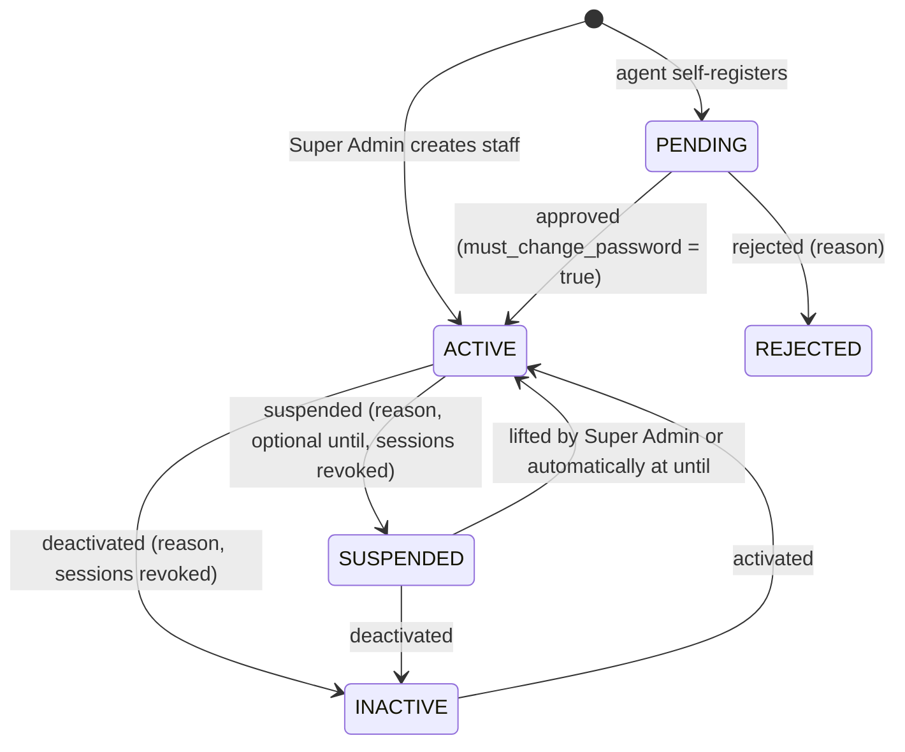

# Spec: iam - Identity & Access

- **Module:** `iam` (PostgreSQL schema `iam`)
- **Status:** carried over from the base project (HautInHousing); describes the code as it is. R59-R69, AC30-AC40 and D20-D21 (company accounts) were approved by the owner on 2026-11-14 and are being built (plans iam#01 to iam#04).
- **Last updated:** 2026-11-14
- **Plans:** [iam#01](../plans/iam/2026-11-14-01-company-linked-accounts.md) (Done, R59-R64, R68, R69 storage and capability; AC30-AC35, AC39, AC40); [iam#02](../plans/iam/2026-11-14-02-ui-company-account-login.md) (In progress), [iam#03](../plans/iam/2026-11-14-03-owner-manages-staff-accounts.md) (Done, R65-R67; AC36-AC38), [iam#04](../plans/iam/2026-11-14-04-ui-owner-staff-screens.md) (In progress)
- **Source:** the Book Inventory business documents, see [docs index](../README.md) (none of the rules below were derived from them yet).

## Base-project rules under review (Book Inventory)

- **Old references in this file:** numbers of removed plans (0001-0012 and others, the plan files are deleted), the ERD and System Design documents (never in this repository), and the modules `mlm`, `finance` and `realty` (no spec exists for them). These are history only: do not look for them and do not build from them.
- **How to work with the rules below:** rules not listed in the table describe the code as it is and stay valid. A listed rule also describes current code, but it belongs to the base project's business: do not extend it or build on it. A Book Inventory feature that touches it changes or retires it through the spec flow, and its row is removed then.

| Rules | What is from the base project | For Book Inventory |
| --- | --- | --- |
| Roles `SALES_CRM`, `ACCOUNTS`, `MEMBER` (section 1, R2, R6, AC24) | The base project's staff and agent roles | Book Inventory roles come from the BRD user and role module; the role list changes through the spec flow |
| R7, R53, R58, D4, D13, AC2, AC10, AC25, AC27, O3, `release-identity` endpoint, `PENDING`/`REJECTED` states | Agent self-registration, generated agent user id and the registration hand-off to `mlm` | Not wanted: `mlm` is not part of Book Inventory |
| R40 events for other modules, D12, O2 | Suspended-agent effects on commission, tree, leads and withdrawals | Not wanted: commission, wallet and `mlm` are not part of Book Inventory |
| R49, AC21 | System account may verify payments and approve commissions and withdrawals | Keep the account mechanism; the list of money actions it covers is re-decided with the `finance` spec |
| D16, D18 | UI history of the base project (neutral branding, SQL Server legacy) | History only |

## 1. Purpose and scope

`iam` answers "who is this caller and what role do they have": accounts, login, sessions, password flows, and the login history. It depends on no other module; every other module depends on it.

In scope: user accounts and their full lifecycle (create, edit, activate, deactivate, suspend, unlock, force logout, reset password), staff creation by Super Admin, login/refresh/logout, password change/forgot/reset/forced change, self-service profile, session management, **status history**, **login log with logout details**.

Also in scope: the hand-off from agent registration (R53), a central message catalogue (R55), configuration of every security value (R54), and one hidden **system account** for developers to verify a deployed build (rules R42-R52). The API also serves the UI from the same origin under `/api` (section 5).

Also in scope (approved 2026-11-14): accounts that belong to a company, the roles `OWNER` and `STAFF`, login with a generated user id, the Owner's management of their Staff, and the rules that tie login to the company's status (R59-R69); the company master itself is in [specs/company.md](company.md).

Out of scope now: two-factor authentication (TOTP). Decided not needed for v1; the design leaves room for it (see section 10).

Out of scope (belongs to other modules): the agent self-registration form, sponsor code, KYC and bank details (`mlm`); the approval *workflow* for agents (`mlm` calls the `iam` activate/reject capability); the system audit trail (`core`); notification delivery beyond a plain email-sending port.

## 2. Concepts and glossary

- **Roles (fixed, no role builder):** `SUPER_ADMIN`, `SALES_CRM`, `ACCOUNTS`, `MEMBER` (an agent), `OWNER` (the main account of a company) and `STAFF` (a login the Owner creates, R60). Role is a column, not a permission table set.
- **Account status** (only `ACTIVE` can log in):
  - `PENDING`: agent registered, awaiting approval.
  - `ACTIVE`: normal working account.
  - `INACTIVE`: deactivated on purpose (left the company, dormant); reactivatable.
  - `SUSPENDED`: temporarily blocked (policy breach, investigation, fraud check) with a reason and an optional end date, after which it lifts by itself.
  - `REJECTED`: agent application refused.
  - Lockout (too many wrong passwords) is **not** a status: it is an automatic short block tracked by `locked_until`.
- **Aggregates:**
  - `AppUser` (root): identity, credentials, role, status (+ reason, until), `must_change_password`, lockout state.
  - `UserStatusHistory` (root): immutable record of every status change.
  - `UserSession` (root): one logged-in device; holds the hashed refresh token. Looked up by token hash, so it is its own root.
  - `PasswordResetToken` (root): single-use reset link token, looked up by hash.
  - `LoginLog` (root): one row per login attempt; insert-only apart from the one-time logout fields.
- **System account:** a single built-in `SUPER_ADMIN` account (`is_system_account = true`) that works exactly like a Super Admin but is invisible in every list, count and search. Provisioned only from deployment configuration, never through the API or UI. Purpose: after a build is deployed, a developer signs in with it to verify the application end to end.
- **Access token:** short-lived JWT. **Refresh token:** opaque random value, only its hash is stored.

## 3. Business rules

**Accounts and lifecycle**
- **R1** Username, email and mobile are each unique (case-insensitive, normalised). A mobile number has one stored form: digits only, a leading `91` on 12 digits or `0` on 11 digits is dropped (Indian numbers, owner decision), so `+91 98765 00001` and `98765 00001` are the same number. An **agent's username is a system-generated user id** created at registration (format of the member code, e.g. `RJ100245`, supplied by the registering module, see R53); **staff** have a username chosen by the Super Admin.
- **R2** Staff accounts (`SUPER_ADMIN`, `SALES_CRM`, `ACCOUNTS`) are created only by a Super Admin, with `must_change_password = true`. Nobody self-registers as staff.
- **R3** A `PENDING`, `REJECTED`, `INACTIVE` or `SUSPENDED` account cannot log in. Approval sets `ACTIVE` and leaves `must_change_password` as it is: the agent chose the password at registration, so no change is forced (owner decision 2026-09-27).
- **R4** Deactivating or suspending an account revokes all its sessions immediately (R31).
- **R5** The last active `SUPER_ADMIN` can never be deactivated, suspended or have its role changed. The hidden system account (R42) is not counted: there must always be at least one *visible* active Super Admin.
- **R6** A Super Admin may change a user's role between the staff roles (`SUPER_ADMIN`, `SALES_CRM`, `ACCOUNTS`) with a reason. The `MEMBER` role never changes (an agent's `mlm` member record depends on it), nobody changes their own role, and R5 still protects the last visible Super Admin. Every change is written to `user_role_history` (from, to, reason, actor, time), raises `UserRoleChanged`, and revokes all the user's sessions so the new role applies on the next login.

**Login**
- **R7** Login takes one identifier and a password: an **agent uses the generated user id**, **staff use their email or username**. Mobile is not a login identifier.
- **R8** Unknown identifier and wrong password return the identical generic error (no account enumeration). A specific message for `PENDING`/`INACTIVE`/`SUSPENDED`/`REJECTED` is only given after the correct password, and never includes the internal reason ("Your account is suspended. Please contact support.").
- **R9** Lockout: after 5 consecutive failed passwords (`Auth:Lockout:MaxFailedAttempts`) the account is locked for 15 minutes (`Auth:Lockout:Minutes`); a success resets the counter.
- **R10** Login and forgot-password are rate limited per client IP.
- **R11** Successful login issues an access token (15 min, claims: user id, role, session id, `must_change_password`, `amr` = `pwd`) returned in the response body and kept by the UI in memory only, and a rotating refresh token in an HttpOnly, Secure, `SameSite=Strict` cookie scoped to the auth path (12 hours, 30 days with "remember me"). A `UserSession` row is created and `last_login_at` is updated. Lifetimes and cookie settings come from `Auth:Tokens:*` (R54).
- **R12** While `must_change_password = true`, the server (not only the UI) allows only change-password, me and logout; every other endpoint returns 403 until the password is changed.

**Sessions**
- **R13** Refresh rotates the refresh token. Presenting an already-used refresh token revokes that session (reuse detection) and is logged; the revoke is committed even though the request is answered 401. A session also has an **absolute life** from its login, `Auth:Tokens:AbsoluteSessionDays` (default 30, never shorter than the remember-me lifetime): refreshing slides the expiry but never past it, and a refresh after it answers `iam.session.expired` (owner decision 2026-09-27).
- **R14** Logout revokes the current session; logout-all revokes every session of the user.
- **R15** A user can list their own active sessions and sign out any of them.

**Passwords**
- **R16** Password policy (`Auth:Password:*`): at least 8 characters with an uppercase letter, a lowercase letter and a digit. Passwords are hashed with PBKDF2-HMAC-SHA512 (210,000 iterations, 16-byte random salt, 64-byte hash) in the self-describing format `$pbkdf2-sha512$<iterations>$<salt>$<hash>`, so the work factor can be raised later and old hashes still verify (the verifier answers "rehash needed"). The cost of *new* hashes is `Auth:Password:Iterations` (default 210,000, allowed 1,000-2,000,000; a value below the default is only for tests and is logged as a warning at startup; Plan 0012). Comparison is fixed-time; the password is never logged, never returned and never stored in the clear. Implemented on the BCL (`Rfc2898DeriveBytes`), no password-hashing package (D19).
- **R17** Forgot password always answers 202 with the same body. If the email belongs to an `ACTIVE` user, a reset link is queued as a notification (R56) and emailed: 256-bit random token, only its SHA-256 stored, valid 30 minutes, single use; a new request invalidates earlier unused tokens.
- **R18** Reset sets the new password, clears `must_change_password`, resets the lockout counter, marks the token used and revokes all the user's sessions.
- **R19** Change password requires the current password, the new one must differ from it, and all *other* sessions of the user are revoked.

**Login log (every login recorded, with logout details)**
- **R20** Every login attempt writes exactly one `LoginLog` row: successes and failures, including unknown identifiers and locked accounts.
- **R21** The failed-attempt log row and the failed-login counter must be persisted even though the request answers 401/423: they are committed independently of the request transaction, which would otherwise roll back on a 4xx.
- **R22** Each row records: user (when the identifier resolved), attempted identifier (masked when the user is unknown, never the password), result (`SUCCESS`, `FAILED_BAD_PASSWORD`, `FAILED_UNKNOWN_USER`, `FAILED_LOCKED`, `FAILED_PENDING`, `FAILED_INACTIVE`, `FAILED_SUSPENDED`, `FAILED_REJECTED`), UTC time, client IP, raw user agent, parsed browser name/version, OS name/version, device type (`DESKTOP|MOBILE|TABLET|BOT|UNKNOWN`), `Accept-Language`, session id, trace id, and whether the device and the IP are new for this user.
- **R23** The client IP is the real caller IP: forwarded headers are honoured only from configured trusted proxies, otherwise the socket address is used (a spoofed `X-Forwarded-For` must not reach the log).
- **R24** When a session ends, its `LoginLog` row gets `logged_out_at` and `logout_reason` exactly once: `USER_LOGOUT`, `LOGOUT_ALL`, `EXPIRED`, `REVOKED_BY_ADMIN`, `REVOKED_BY_USER`, `PASSWORD_CHANGED`, `PASSWORD_RESET`, `ACCOUNT_DEACTIVATED`, `ACCOUNT_SUSPENDED`, `FORCED_LOGOUT`, `REFRESH_REUSE`. A session that simply expires is closed with `EXPIRED` and `logged_out_at = expires_at` (by a periodic sweep, or lazily on the next access). Session duration is derived, not stored.
- **R25** Log rows are never deleted or otherwise edited, and there is no archiving: they stay online indefinitely (owner decision). The table is indexed for the query patterns in section 4 and kept partition-ready by `login_at`, so partitioning can be added later without a rewrite. A new-device / new-IP flag is stored on each row; an email alert for it is deferred until an email provider exists.
- **R26** Visibility: every user sees their own recent logins and active sessions; a `SUPER_ADMIN` can search all logs (by user, role, date range, result, IP) and export them; other roles cannot see anyone else's log.
- **R27** Endpoints require authentication unless stated; ownership is enforced server-side (a user only ever reads their own sessions and log).

**Account management (Super Admin)**
- **R28** Status changes follow only the transitions in the state diagram (`PENDING->ACTIVE|REJECTED`, `ACTIVE->INACTIVE|SUSPENDED`, `INACTIVE->ACTIVE`, `SUSPENDED->ACTIVE|INACTIVE`); anything else is rejected with 409.
- **R29** Only a `SUPER_ADMIN` changes another account's status, and nobody can change their own status. An attempt on your own status answers 409.
- **R30** Reject, deactivate and suspend require a reason (5-500 characters); suspend also accepts an optional `suspended_until` (a future date); activate accepts an optional note.
- **R31** Deactivate and suspend revoke every session of the user at once, close their login-log rows (R24) and make the user's next request fail with 401.
- **R32** A suspension with `suspended_until` lifts to `ACTIVE` by itself when that time passes (periodic job; also enforced lazily at login so it never depends on the job). The lift is recorded with actor `SYSTEM`.
- **R33** Every status change writes an immutable `user_status_history` row: from, to, reason, actor, time, `until`. It is shown on the user's detail page and is never edited or deleted.
- **R34** A locked account (R9) can be unlocked by a Super Admin; this clears `failed_login_count` and `locked_until` and is recorded.
- **R35** A Super Admin can edit another user's full name, email and mobile (uniqueness per R1; username and role stay fixed). Changing your **own** email or mobile requires your current password.
- **R36** A Super Admin can force-logout a user (revoke all sessions), force a password change on next login (`must_change_password = true`), and send a password reset link (R17 flow).
- **R37** Accounts are never deleted. Deactivation is the way to retire an account, so history, audit trails and foreign keys stay intact.
- **R38** The user list is paged and searchable by name, username, email and mobile, filterable by role, status and locked, sortable by created date and last login.
- **R39** The user detail shows: profile, status with reason and `until`, lock state, status history, active sessions and the user's login log.
- **R40** Status changes raise events (`UserActivated`, `UserDeactivated`, `UserSuspended`, `UserRejected`) so other modules can react. Decided: a suspended or deactivated agent cannot log in and `finance` freezes their new withdrawal requests (the fate of an already approved withdrawal is a Super Admin decision). Whether commission keeps accruing, whether the team tree keeps showing them and what happens to their leads is decided in the `mlm`/`finance` specs.
- **R41** Self-service for any logged-in user: view and edit own profile (full name; email/mobile per R35), change password, see own sessions and login history. Role, status and username cannot be changed by the user.

**System account (hidden)**
- **R42** At most one system account exists. It has role `SUPER_ADMIN` and `is_system_account = true`. It is created and updated only by a startup seeder from configuration/secret store (`SystemAccount:*`); no endpoint, screen or event can create, edit, change the status of, reset the password of, or delete it.
- **R43** It is hidden: excluded from every user list, search, count, dropdown, export, report, dashboard total and "assign to" picker; `GET users/{id}` for its id answers 404 exactly like an unknown id; the visible-Super-Admin rule (R5) ignores it. Other modules reach users only through the `iam` user directory, which applies this exclusion, so no module can list it by accident.
- **R44** It authorizes exactly like a Super Admin (role claim `SUPER_ADMIN`), so no module needs a special case. The token additionally carries `sys = 1`, used only to label audit entries.
- **R45** It logs in through the normal login flow (R7-R12); lockout and rate limiting apply to it. Forgot/reset password never works for it, and it is never subject to approval or forced password change.
- **R46** It is usable only when `SystemAccount:Enabled = true`. Owner decision: it is enabled in every environment including Production; the switch exists so it can be turned off without a code change. While disabled, a login attempt fails with the same generic error as an unknown user (R8).
- **R47** Optional `SystemAccount:AllowedIps` (empty by default = any IP): when set, login is accepted only from those addresses (real client IP, R23).
- **R48** Nothing it does is hidden from the audit trail: its logins (R20) and every action are recorded with the real actor id. Audit and login-log screens show it as the fixed label "System" (no username, no id), so accountability exists without exposing the account.
- **R49** Owner decision: it can do everything a Super Admin can, including money-moving and approval actions (verify payment, approve/reject commission, approve/execute withdrawal, clawback, change bank details) in every environment. `SystemAccount:AllowFinancialActions` (default `true`) can switch that off without a code change. Known risk accepted by the owner: an invisible account can move money; the audit trail (R48) and the login alert (R50) are the compensating controls.
- **R50** Its sessions last at most 60 minutes with no refresh beyond that and no "remember me" (mandatory). Every successful login by it writes a security warning to the application log. Optional, off unless configured: `SystemAccount:AlertEmail` (email on login) and `SystemAccount:AllowedIps` (R47).
- **R51** Its username and password come only from configuration or a secret store (never from the repository). Rotating the secret and restarting re-hashes and replaces the stored hash. The username `system` and other reserved names cannot be registered by anyone else (R1).
- **R52** Its own email/mobile are internal placeholders that cannot collide with, or reveal itself through, a real registration (R1 conflict responses stay generic).

**Registration hand-off, configuration and messages**
- **R53** Agent self-registration lives in `mlm`, which calls an `iam` capability to create the login. The user id (R1) is generated at registration time by the registering module, not by `iam`. `Registration:Mode` (appsettings) selects what happens next: `ApprovalRequired` (default) creates the account as `PENDING`, issues no session, and the UI shows a generic welcome message telling the agent to contact the admin team; `InstantLogin` creates it as `ACTIVE`, issues a session and the UI sends the agent straight to the dashboard (no forced password change, they just chose it). Switching mode needs no code change. There is **no email verification** in v1.
- **R54** Every tunable security value comes from appsettings and has the defaults stated in this spec: `Auth:Password:*`, `Auth:Lockout:*`, `Auth:Tokens:*` (access and refresh lifetimes, remember-me lifetime, cookie name/path/`SameSite`), rate limits, `Registration:Mode`, `SystemAccount:*`. Startup fails on an invalid value. Because the framework's data-annotation validation does not descend into a nested options object, a section that groups values in sub-objects (`Auth:*`) validates itself, so the ranges below really do stop startup.
- **R55** No user-facing text is hard-coded in code. Errors carry a stable machine code (for example `iam.auth.invalid_credentials`) and the human text lives in one message catalogue per side: a backend messages constants class and one UI constants/i18n file. Login errors, status messages, the registration welcome message and validation texts all come from there.
- **R56** iam never sends email itself. It **records a notification** through the `core` notification outbox (`INotificationService`, [specs/core.md](core.md) N1-N14) in the same transaction as the change that needs it (for example the `PASSWORD_RESET` mail of R17); a background worker renders the template, sends it, retries and logs every attempt. iam owns the default text of its templates (`PASSWORD_RESET`); the reset link is a variable of a sensitive notification and is redacted from the database once the mail is sent or given up (core N9). The provider is chosen later (core CO1); until then the logging sender is used, so forgot-password works end to end in development and the flow needs no change when SMTP is configured.
- **R57** When a Super Admin creates a staff account, the system generates a random temporary password and shows it **once** on screen (it is never retrievable again); the staff member must change it at first login (R2, R12).
- **R58** Rejection of an agent is final. Their email and mobile stay reserved until a Super Admin releases them (`release-identity`); only then can a new application use them. Every release is recorded.

**Company accounts (Approved 2026-11-14)**
- **R59** `app_user` has an optional `company_id`, a plain id with no navigation. Every `OWNER` and `STAFF` account has one; the `SUPER_ADMIN` accounts and the hidden system account (R42) have none. It is set at creation and never changed. Email and mobile are optional for company accounts (still unique when given, R1).
- **R60** Role `OWNER` is the main account of a company; role `STAFF` is a login created by the Owner. `OWNER` is created only through R61 and `STAFF` only through R65, never through staff creation (R2). Nobody's role changes to or from `OWNER` or `STAFF` (R6 treats them as it treats `MEMBER`). Both are deactivated, suspended and unlocked like any account (R28-R36); R5 is unaffected.
- **R61** The `company` module creates the Owner through an `iam` capability, inside the caller's request transaction: `ACTIVE`, `must_change_password = true`, the user id generated by the `company` module from the company's name ([specs/company.md](company.md) D4), a system-generated temporary password returned once to the caller (R57), uniqueness of the user id per R1. A business exception (409, 400) rolls the caller's whole transaction back (the same pattern as R53).
- **R62** The access token of a company account carries the company id as claim `cid`, in addition to the claims of R11; for a Super Admin who entered a company it carries that company's id (R69). Other modules read it only through an app-level `ICurrentCompany`, never from a request. A caller with no company context has no `cid`.
- **R63** While the company of an account is `INACTIVE` ([specs/company.md](company.md) R7) that account (Owner or Staff) cannot log in and its existing sessions end: the next request answers `401`. Before the correct password the error is the generic one (R8); after it, the message code is `iam.auth.company_inactive`. `iam` offers `company` a capability that revokes every session of a company's accounts (as R31 does for one user). The company's status is read through a port defined in `iam` and implemented by `company`, so `iam` code never references `company` types.
- **R64** A company account logs in only with its **user id** and password; its email and mobile are not login identifiers (this narrows R7 for company accounts; `SUPER_ADMIN` keeps email or username). The unknown-identifier and wrong-password answers stay identical (R8).
- **R65** An Owner creates `STAFF` accounts for their own company only: the user id is `<owner user id>.<short name>` (the short name is 2-20 lower-case letters or digits, [specs/company.md](company.md) Q15; user ids may be up to 64 characters), and a taken id answers `409`, the company id is the Owner's, `ACTIVE`, `must_change_password = true`, a temporary password returned once (R57). The Owner can create no other role.
- **R66** An Owner sees and manages only the `STAFF` accounts of their own company: list (paged, searchable), detail, deactivate, reactivate, force logout and unlock (R28-R31, R34, R36 apply; a reason is required as in R30). Another company's accounts, and every `OWNER` account, answer `404`, byte-identical to an unknown id. A Super Admin keeps managing every account (R28-R41).
- **R67** Because company accounts have no email, a forgotten password is reset by a person, not by a mail: the Super Admin resets any Owner or Staff password and the Owner resets the password of their own Staff. The reset sets a new system-generated temporary password, shown once, with `must_change_password = true`, and revokes every session of that account. Each reset is recorded with actor and time in `user_password_reset` (insert-only, section 4). R17 (reset by mail) is not available to accounts without an email.
- **R68** `STAFF` is denied by default: a Staff account can call only the endpoints that name the role `STAFF` (and the self-service endpoints of R41), and none of `companies`, account management or any master/configuration endpoint does. Which business endpoints name `STAFF` (creating orders and selling to customers) is decided by the business modules ([specs/company.md](company.md) R14, Q14).
- **R69** A Super Admin's session may carry an `active_company_id`, set and cleared only through an `iam` capability that the `company` module calls when the Super Admin enters or leaves a company ([specs/company.md](company.md) R13). It is stored on the `user_session` row, ends with the session, and is used as the company of that session (R62). Only a `SUPER_ADMIN` session can carry it.

## 4. Data

Tables in schema `iam`: `app_user` (adds `failed_login_count`, `locked_until`, `password_changed_at`, `status_reason`, `status_changed_at`, `status_changed_by`, `suspended_until`), `is_system_account` (default false; a partial unique index allows at most one true), `user_session` (adds `last_seen_at`, `revoke_reason`), `user_role_history` (append-only role changes), `password_reset_token`, `user_login_log`, `user_status_history`.

Company accounts: `app_user.company_id` (R59), `user_session.active_company_id` (R69) and the insert-only `user_password_reset` (`user_id`, `reset_by`, `reset_at`, R67), all plain ids with no foreign key to `company`.

Hiding is implemented once, in the data layer, as a named EF query filter on `app_user` (`is_system_account = false`) that every normal query gets automatically; only the login/identity lookup and the seeder opt out of it. New queries are therefore safe by default.

Indexes worth having: `user_login_log (user_id, login_at desc)`, `(ip_address, login_at desc)`, `(result, login_at desc)`; `user_session (refresh_token_hash)` unique; `password_reset_token (token_hash)` unique.

## 5. API contract (`/api/v1`)

Hosting (owner decision): the API serves the Angular UI from the same origin, so calls are relative (`/api/v1/...`) and CORS is only needed for local development (`http://localhost:4200`). The refresh cookie is `SameSite=Strict`.

| Method + route | Who | Notes |
|---|---|---|
| `POST auth/login` | anonymous | `{identifier, password, rememberMe}` -> access token + user + `mustChangePassword`; sets refresh cookie. Agents pass their generated user id; staff their email or username |
| `POST auth/refresh` | cookie | rotates refresh token, returns new access token |
| `POST auth/logout` / `auth/logout-all` | any authenticated | revokes current / all sessions |
| `GET auth/me` | any authenticated | profile, role, `mustChangePassword` |
| `POST auth/change-password` | any authenticated (also while forced) | `{currentPassword, newPassword}` |
| `POST auth/forgot-password` | anonymous | `{email}` -> always 202 |
| `GET auth/reset-password/verify?token=` | anonymous | validity only |
| `POST auth/reset-password` | anonymous | `{token, newPassword}` |
| `GET auth/sessions`, `DELETE auth/sessions/{id}` | any authenticated | own sessions only |
| `GET auth/login-history` | any authenticated | own log, paged |
| `POST users`, `GET users`, `GET users/{id}` | `SUPER_ADMIN` | create staff (response shows the temporary password once, R57), paged list (filter role/status/search), detail |
| `POST users/{id}/change-role` | `SUPER_ADMIN` | staff roles only, `{role, reason}` (R6) |
| `POST users/{id}/release-identity` | `SUPER_ADMIN` | frees a rejected agent's email/mobile (R58) |
| `PUT users/{id}` | `SUPER_ADMIN` | edit full name, email, mobile (R35) |
| `POST users/{id}/activate`, `/deactivate`, `/suspend`, `/approve`, `/reject` | `SUPER_ADMIN` | status changes (R28-R33); body `{reason, suspendedUntil?}` |
| `POST users/{id}/unlock`, `/force-logout`, `/force-password-change`, `/reset-password` | `SUPER_ADMIN` | R34, R36 |
| `GET users/{id}/status-history` | `SUPER_ADMIN` | R33 |
| `PUT auth/profile` | any authenticated | own profile (R41); email/mobile change needs `currentPassword` |
| `GET users/{id}/sessions`, `DELETE users/{id}/sessions/{sid}` | `SUPER_ADMIN` | inspect / revoke |
| `GET login-logs`, `GET login-logs/export` | `SUPER_ADMIN` | filtered search and CSV |
| `POST staff` | `OWNER` | `{fullName, shortName}` -> `201` with `{userId, temporaryPassword}` shown once (R65); `409` when the user id is taken |
| `GET staff`, `GET staff/{id}`, `GET staff/{id}/sessions` | `OWNER` | the Owner's own company's Staff only; anything else answers `404` (R66) |
| `POST staff/{id}/deactivate`, `/activate`, `/unlock`, `/force-logout` | `OWNER` | R66; deactivate needs a reason (R30) |
| `POST staff/{id}/temporary-password` | `OWNER` | new temporary password shown once (R67) |
| `POST users/{id}/temporary-password` | `SUPER_ADMIN` | same, for any Owner or Staff (R67) |

Errors are RFC 9457 problem details: 400 validation, 401 bad credentials/token, 403 forbidden or `must_change_password`, 409 duplicate username/email/mobile, 423/429 locked or rate limited (with `Retry-After`).

There is deliberately no endpoint to create or manage the system account (R42).

## 6. Events

`UserDeactivated` / `UserSuspended` -> revoke sessions and close their log rows (`ACCOUNT_DEACTIVATED` / `ACCOUNT_SUSPENDED`). `PasswordChanged` / `PasswordReset` -> revoke sessions (R18, R19). `UserActivated` / `UserRejected` are raised for `mlm` to react to; `UserSuspended` / `UserDeactivated` also let `finance` freeze withdrawals (R40). `UserRoleChanged` -> revoke sessions (R6). Other modules may read `core` audit entries produced from these events.

## 7. Dependencies

None on other modules' code. For R63 `iam` defines a port that answers whether a company is active; `company` implements it. Needs ports implemented in Infrastructure: `INotificationService` from `core` (reset link, R56; Plan 0011 must exist first), `TimeProvider`, and a user-agent parser (the `UAParser` package, approved by the owner; no GeoIP in v1). `ICurrentUser` (BuildingBlocks) is filled from the access token claims.

## 8. Acceptance criteria

- **AC1** A staff user created by Super Admin can log in, is forced to change the password, and cannot call any other endpoint until they do (R2, R12).
- **AC2** An agent logs in with the generated user id and a staff user with their email or username; wrong password and unknown user return byte-identical errors; an agent cannot log in with email or mobile (R7, R8).
- **AC3** The 5th consecutive wrong password locks the account for 15 minutes even if the 6th attempt is correct (R9).
- **AC4** Every login attempt above, including the failures and the locked one, appears in the log after the request has returned an error (R20, R21).
- **AC5** A successful login row shows IP, browser, OS and device parsed from a real user agent; a forged `X-Forwarded-For` from an untrusted client does not change the IP (R22, R23).
- **AC6** After logout the same row shows `logged_out_at` and `USER_LOGOUT`; after Super Admin deactivates the user it shows `ACCOUNT_DEACTIVATED`; an expired session shows `EXPIRED` (R24).
- **AC7** Reusing a refresh token revokes the session and logs `REFRESH_REUSE` (R13).
- **AC8** Forgot password answers identically for known and unknown emails; a reset link works once, expires after 30 minutes, and afterwards every old session is dead (R17, R18).
- **AC9** The last Super Admin cannot be deactivated or suspended (R5).
- **AC10** An agent sees only their own log; Super Admin can filter and export all (R26).
- **AC11** Suspending a logged-in user with a reason kills their session immediately, the next login says the account is suspended (without the reason), and the status history shows who, why and when (R30, R31, R33).
- **AC12** A suspension whose `suspended_until` has passed allows login again as `ACTIVE`, and the history shows the lift by `SYSTEM` (R32).
- **AC13** Invalid transitions (e.g. `INACTIVE -> SUSPENDED`, `REJECTED -> ACTIVE`) return 409; nobody can suspend or deactivate themselves (R28, R29).
- **AC14** A locked account can be unlocked by Super Admin and then logs in with the correct password (R34).
- **AC15** Editing a user's email to one already in use returns 409; a user's own email change needs their password (R35).
- **AC16** The user list can be filtered by role, status and locked, searched by name/email/mobile/username, and is paged (R38).
- **AC17** With the system account enabled, it can log in and call Super Admin endpoints, yet it appears in no list, search, count, export or dropdown, and `GET users/{id}` for its id is 404 (R42-R44).
- **AC18** No API call by any user, including a Super Admin, can create, edit, suspend, deactivate, reset or delete it (R42); every such call against its id answers the same 404 as an unknown id (owner decision 2026-09-27).
- **AC19** With `SystemAccount:Enabled = false` its login fails like an unknown user (R46); with `AllowedIps` set, a login from another IP fails (R47).
- **AC20** The last *visible* Super Admin still cannot be deactivated, even though the hidden one exists (R5).
- **AC21** By default the system account can verify payments and approve commissions/withdrawals like any Super Admin; with `SystemAccount:AllowFinancialActions = false` the same calls return 403 (R49).
- **AC22** Its login and actions appear in the audit trail under the label "System" with the real actor id stored (R48).
- **AC23** Its login writes a security warning log (and an email when configured) and its session is capped at 60 minutes (R50).
- **AC24** A Super Admin changes a `SALES_CRM` user to `ACCOUNTS`: the change is in `user_role_history`, the user's sessions are revoked and the new role applies at next login; changing a `MEMBER`, changing your own role, or demoting the last visible Super Admin is refused (R6, R5).
- **AC25** With `Registration:Mode = ApprovalRequired` a new agent gets no session and sees the generic welcome message; with `InstantLogin` the account is `ACTIVE`, a session is issued and the UI lands on the dashboard; flipping the setting needs no code change (R53).
- **AC26** Creating a staff account returns a temporary password exactly once, it cannot be fetched again, and the first login forces a change (R57, R12).
- **AC27** A rejected agent cannot re-register with the same email/mobile until a Super Admin releases them (R58).
- **AC28** No user-facing string is hard-coded: a search of the API and UI source finds every message through the catalogue, and an unknown code falls back to a generic message (R55).
- **AC29** Invalid appsettings (for example a token lifetime of 0) stop the application at startup (R54).
- **AC30** An Owner created through R61 is `ACTIVE`, must change the temporary password at first login and can call nothing else until then; a taken user id answers `409` and leaves no account behind (R12, R60, R61).
- **AC31** The Owner's access token carries `cid` equal to the company id; a Super Admin's token has no `cid` until they enter a company (R59, R62, R69).
- **AC32** Creating a staff account (R2) with role `OWNER` or `STAFF`, changing an Owner's or Staff's role, or changing anyone's role to `OWNER` or `STAFF` is rejected with `400` (`iam.user.role_not_staff` on creation, `iam.user.company_role_immutable` on a role change) (R6, R60).
- **AC33** With the company `INACTIVE`: a company account's login with the correct password is refused with `iam.auth.company_inactive`, with a wrong password it is the generic error, and an existing access token answers `401` on the next request (R63, R8).
- **AC34** After the company is reactivated, its accounts can log in again (R63).
- **AC35** A company account logs in with its user id; the same account's email or mobile (if it has one) as identifier gets the generic error (R64, R8).
- **AC36** An Owner creates a Staff `childrenbookcenter.ramesh` (example): `201` with the temporary password once, company id equal to the Owner's, forced password change at first login; a second Staff with the same id answers `409`; the Owner cannot create an `OWNER`, `SUPER_ADMIN` or any other role (R65).
- **AC37** The Owner of A lists only A's Staff; `GET users/{id}` of B's Staff, of A's Owner or of any Super Admin answers `404` like an unknown id; deactivating A's Staff without a reason is rejected, with a reason it works and the Staff's sessions end (R66, R30, R31).
- **AC38** Resetting a Staff password as the Owner of A, and an Owner password as Super Admin: a new temporary password is returned once, the account must change it at next login, its old sessions end, and a reset row records actor and time; the Owner of B cannot reset A's Staff (`404`) (R67).
- **AC39** A Staff account calling `companies`, `users`, `POST users`, or any endpoint that does not name `STAFF` gets `403`; its self-service endpoints (own profile, change password) work (R68, R41).
- **AC40** A Super Admin session with an entered company carries that company's id as `cid`; after leaving there is none; a session of any other role cannot carry one (R69).

## 9. Decisions (owner, 2026-09-26) and remaining open items

| # | Decision |
|---|---|
| D1 | Primary keys are UUID v7 (ERD conventions). A `platform` plan aligns BuildingBlocks first (Guid keys, `created_at`-style audit columns, singular snake_case tables, `iam` schema, enums as text with CHECK). |
| D2 | Access JWT held in browser memory, rotating refresh token in an HttpOnly cookie hashed in `user_session`; nothing in `localStorage`. All values configurable in appsettings (R11, R54). |
| D3 | Same-origin hosting: the API serves the UI under `/api`; CORS only for local dev; `SameSite=Strict`. |
| D4 | Agents log in with a user id generated at registration; staff with email or username (R1, R7). |
| D5 | No email verification in v1; a global email port exists, provider chosen later. After registration a generic welcome message is shown, unless `Registration:Mode = InstantLogin` (R53, R56). |
| D6 | All user-facing messages come from one central catalogue, never hard-coded (R55). |
| D7 | Security defaults: password 8+ with upper/lower/digit, 5 failures -> 15 min lock, access 15 min, refresh 12 h (30 days with remember me); all configurable (R9, R11, R16, R54). |
| D8 | A new staff account gets a temporary password shown once to the Super Admin (R57). |
| D9 | Role may change between staff roles by a Super Admin, with history (R6). |
| D10 | Login log kept online forever, no archive; partition-ready (R25). New-device alert email deferred. |
| D11 | `UAParser` package approved; no GeoIP in v1. |
| D12 | Suspended/deactivated agent: login blocked and new withdrawals frozen; commission, tree and leads effects decided in `mlm`/`finance` specs (R40). |
| D13 | Agent rejection is final; a Super Admin releases the email/mobile (R58). |
| D14 | Only Super Admin approves, rejects, suspends and deactivates (R29). |
| D15 | System account: shown as "System" in audit, full admin including money, enabled in Production, 60-minute sessions mandatory; IP allowlist, alert email and long-password requirement are optional and off by default (R46-R50). |
| D16 | UI: the existing Angular UI is the product's real UI (it ran on SQL Server; the new project exists only because of PostgreSQL) and is **kept in full**. Only the backend-facing layer is adapted (auth, interceptors, environment, models, catalogue); business pages are hidden by a feature switch until their module's API exists, never deleted. Snapshot commit/tag `legacy-snapshot` taken first. Specs and plans live in this repo; each plan has an Api section and a Ui section. |
| D18 | UI branding is a neutral placeholder for now; real logo/colours come later (Plan 0002). Migrations may be applied by the assistant to the local dev database `book_inventory` only, with the SQL shown first. |
| D17 | The request `TransactionFilter` rolls back on 4xx, which would lose failed-login logs (R21). BuildingBlocks gets an explicit per-endpoint attribute that commits the work done before an error status; designed in the `platform` plan. |
| D19 | Password hashing uses PBKDF2-HMAC-SHA512 from the BCL (`Rfc2898DeriveBytes`), self-describing format `$pbkdf2-sha512$<iterations>$<salt>$<hash>`, instead of a third-party hashing package: the project stays package-free for this concern, the work factor can be raised without invalidating stored hashes, and the verifier reports when a rehash is due. The seeded system-account password is only stored hashed like any other (R16, R50). |
| D20 | Company accounts: `iam` stores only company ids and offers capabilities; the `company` module owns the company and calls them (R59-R63, R69). The company id travels in the token claim `cid`. (proposed by the assistant, approved by the owner on 2026-11-14) |
| D21 | Owner decisions of 2026-11-14: company accounts log in with a user id generated from the company name, never with email or mobile (R64); the company creates its Staff logins (R65); Staff may only create orders and sell to customers (R68); the Super Admin may enter a company and work with its data (R69). See [specs/company.md](company.md) D3-D6. |

Remaining open items (none block approval of this spec):
- **O1** Email provider and the production `Email:*` values: tracked as CO1 in [specs/core.md](core.md); templates are recorded there (N13) and owned per module.
- **O2** Commission accrual, team-tree visibility and lead ownership for a suspended/deactivated agent: decided in the `mlm`/`finance` specs (R40).
- **O3** The exact format and generator of the agent user id (member code) belongs to the `mlm` registration spec (R1, R53).
## 10. Decided, deferred: two-factor authentication

**Decision (owner, 2026-09-26): no 2FA in v1; it may be added later** (the motivation is that `SUPER_ADMIN` and `ACCOUNTS` approve and execute payouts). Nothing is built now, but v1 must not block it:
- Login is modelled as steps: password check -> optional second factor -> session issued. v1 has only the first step, so a later `MFA_REQUIRED` login response adds a step without changing the token/session design.
- The access token carries an authentication-method claim (`amr`, v1 value `pwd`), so a future rule such as "withdrawal approval needs `mfa`" can be enforced per endpoint.
- Future columns/tables (`mfa_enabled`, TOTP secret stored encrypted, recovery codes hashed) get their own plan and a spec update; `user_login_log.result` would gain `FAILED_MFA`.
- Rule for now: do not add TOTP, recovery codes or MFA UI until a plan for it is approved.
